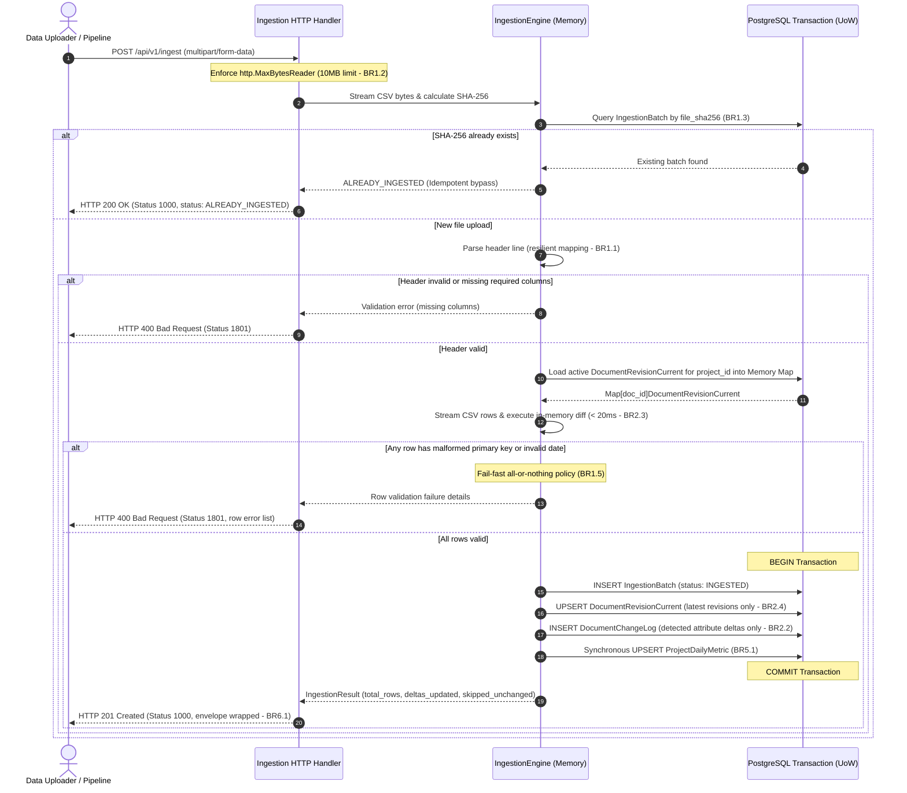
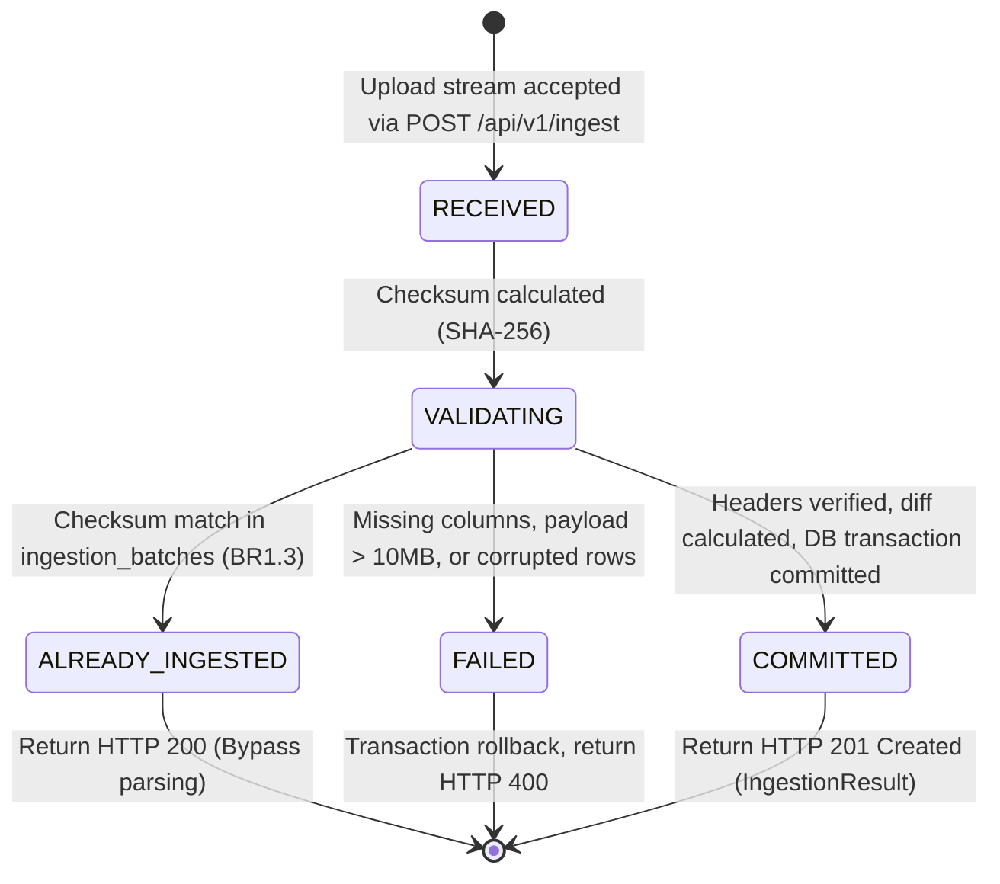
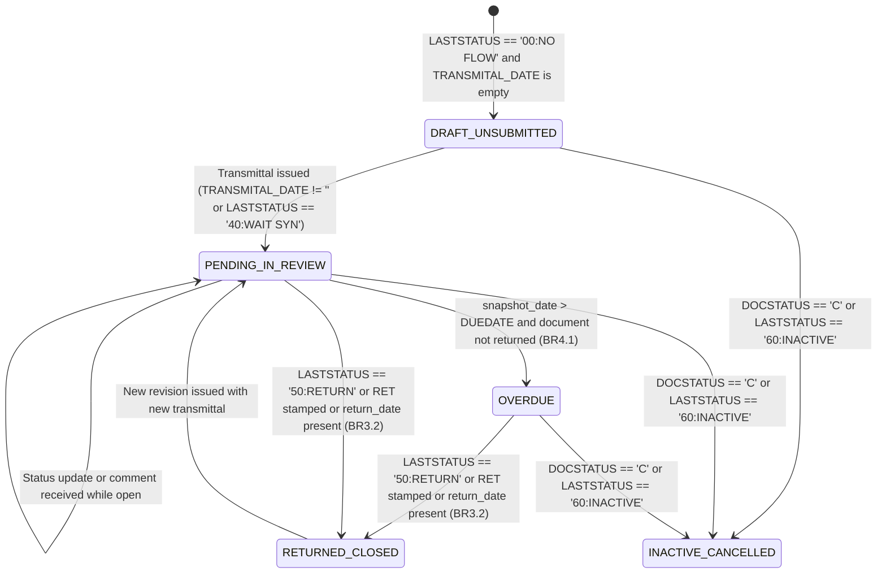
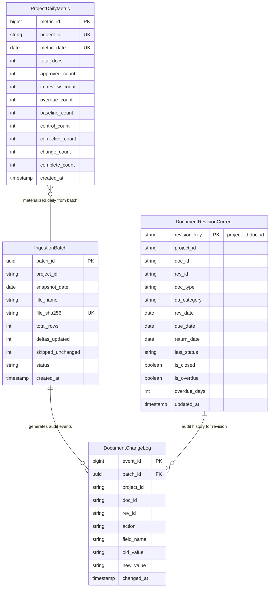

# Functional Specification: Unit `backend`

**Stage**: `functional-design` (3.1)  
**Unit**: `backend` (`U1`, kind: `service`, directory: `backend`)  
**Lead Agent**: `aidlc-architect-agent`  
**Support Agent**: `aidlc-developer-agent`  
**Date**: 2026-10-16  

---

## 1. Upstream Traceability & Provenance

This functional specification serves as the authoritative source of truth for ordered workflows, algorithmic state machines, and API behavior for the Go backend service and PostgreSQL storage layer, tracing from:
- `unit-of-work.md`: Unit definition for `backend` (`U1`) and its component ownership boundaries.
- `unit-of-work-story-map.md`: Traceability to stories `US1.1`, `US1.2`, `US1.3`, `US3.1`, and `US3.2`.
- `requirements.md`: Upstream requirements `FR1.1`–`FR1.6`, `FR2.1`–`FR2.3`, `FR3.2`–`FR3.4`, `FR5.1`, and `NFR1`–`NFR4`.
- `components.md`: Domain architecture components `IngestionEngine`, `DocumentTrackingDomain`, and `HistoricalAnalyticsDomain`.
- `contract-summary.md`: OpenAPI 3.0 interface specifications and response DTO schemas.

---

## 2. Behavioral Workflows & Step Sequences

### Workflow 1: Daily Snapshot CSV Ingestion & Atomic Delta Processing

This workflow specifies the complete end-to-end processing sequence executed when a daily snapshot CSV is uploaded to `POST /api/v1/ingest`:

#### Detailed Execution Steps:
1. **Transport Ingestion**: The HTTP handler mounts `http.MaxBytesReader` configured with a 10MB ceiling (`BR1.2`). Payloads exceeding 10MB are severed immediately.
2. **Streaming Checksum**: While reading the multipart stream into memory/disk buffer, compute the SHA-256 digest across raw bytes.
3. **Idempotency Verification**: Query `ingestion_batches` for existing `file_sha256` (`BR1.3`). If present, return HTTP 200 `ALREADY_INGESTED` with previous batch statistics.
4. **Header Normalization**: Parse the first CSV row using case-insensitive, whitespace-trimmed token matching (`BR1.1`). Verify presence of all 23 required columns.
5. **State Pre-Loading**: Query `document_revisions_current` where `project_id == parsed_project_id`, populating an in-memory hash map `docMap[doc_id]` in $< 5\text{ ms}$.
6. **Streaming In-Memory Diffing**: Iterate through incoming rows:
   - Validate presence of mandatory identifiers `PROJECTID`, `DOCID`, `REVID`, `DOCTYPE`. If validation fails, capture row number and column error (`BR1.5`).
   - If `doc_id` exists in `docMap`:
     - Compare `incoming.rev_date` against `current.rev_date`. If incoming is older, discard row to prevent historical regression (`BR1.4`).
     - Compare all 23 tracked attributes. If identical, increment `skipped_unchanged` (`BR2.1`).
     - If attributes differ, flag revision for UPSERT and construct discrete `DocumentChangeLog` event rows for each mutated field (`BR2.2`).
   - If `doc_id` does not exist in `docMap`:
     - Flag revision for creation UPSERT and construct a `DocumentChangeLog` event with `action = 'CREATE'`.
7. **Atomic Transaction Commit**:
   - Begin PostgreSQL transaction.
   - Insert new `IngestionBatch` record.
   - Execute bulk UPSERT on `document_revisions_current` on conflict `(revision_key)`.
   - Bulk insert generated `DocumentChangeLog` rows.
   - Compute and UPSERT the `ProjectDailyMetric` record for `(project_id, snapshot_date)` (`BR5.1`).
   - Commit transaction. If any database write fails, execute immediate rollback.
8. **Response Packaging**: Return HTTP 201 Created with JSON envelope (`BR6.1`).

---

### Workflow 2: Global Executive Summary Delivery

This workflow powers the topbar executive KPI cards (`GET /api/v1/projects/summary`):

1. **Request Intake**: Handler receives `GET /api/v1/projects/summary` without required query parameters.
2. **Aggregated Metric Query**: Application service invokes the repository port to execute an indexed aggregation query against `document_revisions_current`:
   - `total_projects`: `COUNT(DISTINCT project_id)`
   - `total_documents`: `COUNT(*)`
   - `total_overdue`: `COUNT(*) FILTER (WHERE is_overdue = TRUE)`
   - Category counts:
     - `baseline_drawings`: `COUNT(*) FILTER (WHERE qa_category = 'BASELINE_DRAWINGS')`
     - `control`: `COUNT(*) FILTER (WHERE qa_category = 'CONTROL')`
     - `corrective`: `COUNT(*) FILTER (WHERE qa_category = 'CORRECTIVE')`
     - `change`: `COUNT(*) FILTER (WHERE qa_category = 'CHANGE')`
     - `complete`: `COUNT(*) FILTER (WHERE qa_category = 'COMPLETE')`
   - `last_updated_at`: `MAX(updated_at)`
3. **Execution Latency SLA**: Query leverages the composite index `idx_doc_rev_curr_query` executing in $< 3\text{ ms}$.
4. **Envelope Serialization**: Output is mapped into `GlobalSummaryResponse` wrapped in the universal JSON envelope (`BR6.1`) and returned with HTTP 200 OK.

---

### Workflow 3: Multi-Project Comparative Matrix Grid

This workflow serves the comparative project overview table (`GET /api/v1/projects`):

1. **Parameter Sanitization**:
   - `search`: Trimmed string; if provided, matched case-insensitively against `project_id` or `site_code`.
   - `page`: Default 1, minimum 1.
   - `page_size`: Default 20, minimum 1, maximum 100.
2. **Project-Level Rollup Aggregation**:
   - For each active project matching search filters, aggregate current metrics from `document_revisions_current`:
     - Total baseline drawings count.
     - Category metrics for Control, Corrective, and Change: `total`, `open`, `closed`, `pending_pct` (`BR4.2`), `is_critical` (`BR4.2`), and `avg_age_days` (`BR3.4`).
     - Overdue document count (`BR4.1`).
     - Stated `last_snapshot_date`.
3. **Week-over-Week Net Change Evaluation**:
   - For each project, fetch the two most recent records from `project_daily_metrics` (current vs 7 days prior).
   - Compute `delta_open = current.in_review_count - previous.in_review_count`.
   - Assign `net_change` as `IMPROVING`, `DEGRADING`, or `STABLE` (`BR4.3`).
4. **Pagination Packaging**: Assemble `ProjectMatrixRow` collection, populate `total` matching projects, and echo `search_params` in the standard response envelope.

---

### Workflow 4: Historical Time-Series Analytics Assembly

This workflow serves multi-project trend curves (`GET /api/v1/analytics/trends`):

1. **Parameter Parsing**:
   - `project_ids`: Comma-separated list of target project IDs.
   - `preset`: Predefined window (`all_time`, `1_year`, `6_months`, `3_months`). If supplied, calculate `start_date` relative to current date.
   - `start_date` / `end_date`: Explicit ISO calendar bounds (YYYY-MM-DD).
2. **Direct Rollup Table Query**:
   - Query `project_daily_metrics` filtering strictly by `project_id IN (...)` and `metric_date BETWEEN start_date AND end_date`, ordered by `metric_date ASC`.
   - Bypasses raw revision tables entirely; query runs in $< 5\text{ ms}$ over 2+ years of data.
3. **Date Pivoting & Data Structuring**:
   - Pivot queried rows into a unified time-series array of `DateMetricPoint` objects.
   - Each date element contains a map of project IDs to their respective `total_documents` and `overdue_count` metrics on that calendar date.
4. **Response Serialization**: Return `HistoricalTrendsResponse` with HTTP 200 OK and populated `search_params`.

---

## 3. State Machines & Lifecycle Transitions

### 3.1 Ingestion Batch Lifecycle State Machine

### 3.2 Document Revision Composite Lifecycle State Machine

---

## 4. Derived Views

### 4.1 Derived Entity-Relationship Diagram

Derived from the authoritative definitions in `entities.md`:

---

## 5. Derived Business Rules Reference Summary

Derived from the authoritative rules in `rules.md`:

| Rule Group | Rules Included | Key Invariants Enforced |
|:---|:---|:---|
| **Ingestion Core (`BR1.x`)** | `BR1.1`, `BR1.2`, `BR1.3`, `BR1.4`, `BR1.5` | Resilient 23-column header mapping; 10MB request ceiling; SHA-256 deduplication; out-of-order date safeguard; atomic transactional commit/rollback. |
| **Delta Engine (`BR2.x`)** | `BR2.1`, `BR2.2`, `BR2.3`, `BR2.4` | Unchanged row suppression; attribute delta logging to `document_change_log`; $< 20\text{ ms}$ diffing SLA; single active row in `document_revisions_current`. |
| **Lifecycle & Classification (`BR3.x`)** | `BR3.1`, `BR3.2`, `BR3.3`, `BR3.4` | 5 QA/QC category mapping; composite closure evaluation; ME/CE/EE discipline categorization; unified Corrective Action aging (no directional split). |
| **Delinquency & Overdue (`BR4.x`)** | `BR4.1`, `BR4.2`, `BR4.3` | Overdue anchor against snapshot date; $\ge 45\%$ delinquency critical alert; week-over-week net backlog direction. |
| **Rollup & Analytics (`BR5.x`)** | `BR5.1`, `BR5.2` | Synchronous `project_daily_metrics` rollup insertion; full-lifecycle multi-project time-series streaming. |
| **Presentation Envelope (`BR6.x`)** | `BR6.1`, `BR6.2` | Universal four-field JSON envelope (`status`, `result`, `total`, `search_params`); sanitized status code mapping. |

