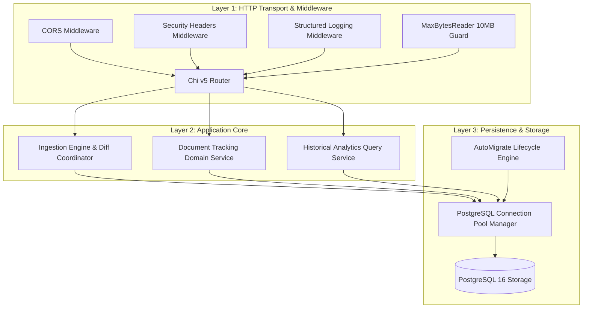

# Logical Components Architecture: Unit `backend`

**Stage**: `nfr-design` (3.3)  
**Unit**: `backend` (`U1`, kind: `service`, directory: `backend`)  
**Lead Agent**: `aidlc-architect-agent`  
**Support Agents**: `aidlc-aws-platform-agent`  
**Date**: 2026-10-16  

---

## 1. Upstream Traceability & Scope

This specification provides the logical component architecture, service boundaries, failure domains, blast radius mapping, and resource isolation model for the backend service, connecting NFR design patterns to concrete implementation modules.

---

## 2. Logical Component Topology

The backend service is structured into 5 cohesive logical components respecting the Clean Architecture inward dependency rule:

---

## 3. Component Master Register

| Component Identifier | Package Path | Primary Responsibilities | Failure Domain | Blast Radius |
|:---|:---|:---|:---|:---|
| **`C1: Transport & Middleware`** | `internal/transport/http/` | HTTP request routing, CORS allowlist, security headers injection, request ID generation, body size limits. | Network / Ingress | Single incoming HTTP connection (terminated with 4xx). |
| **`C2: Ingestion Engine`** | `internal/ingest/` | Streaming CSV reading, SHA-256 deduplication, formula sanitization, in-memory diffing, project lock coordination. | Data Intake | Active snapshot batch (fails fast with 400/409; zero DB corruption). |
| **`C3: Tracking Domain`** | `internal/domain/` | Latest revision evaluation, 5 QA/QC category mapping, overdue status determination, delta change generation. | Business Logic | In-memory evaluation failure (caught by service test suite). |
| **`C4: Analytics Engine`** | `internal/service/` | Executive KPI aggregation, matrix grid assembly, week-over-week net change, time-series historical pivots. | Read Presentation | Single read query failure (returns 500 without impacting data). |
| **`C5: Persistence Engine`** | `internal/repository/` | PostgreSQL connection pool tuning, transaction atomicity (`Begin`/`Commit`/`Rollback`), GORM schema migrations. | Data Persistence | Database connectivity outage (causes 503 health degradation). |

---

## 4. Failure Domains & Blast Radius Isolation

1. **Ingestion Isolation**:
   - An invalid or corrupted CSV file uploaded for `PRJ-001` triggers an immediate transaction rollback.
   - *Blast Radius*: Strictly confined to that single upload request. Dashboard read queries for all projects and ingestion batches for other projects continue unaffected.
2. **Read Query Isolation**:
   - Read queries execute under read-committed transaction isolation without acquiring row locks on the active state table.
   - *Blast Radius*: An unexpected read query failure returns an isolated HTTP 500 JSON envelope without blocking writes or causing server panics.
3. **Database Outage Resilience**:
   - If PostgreSQL disconnects temporarily, connection pool background routines attempt automated reconnection while `/api/v1/health` reports 503.
   - *Blast Radius*: System enters a safe degraded state until connectivity restores, avoiding zombie connection accumulation.

