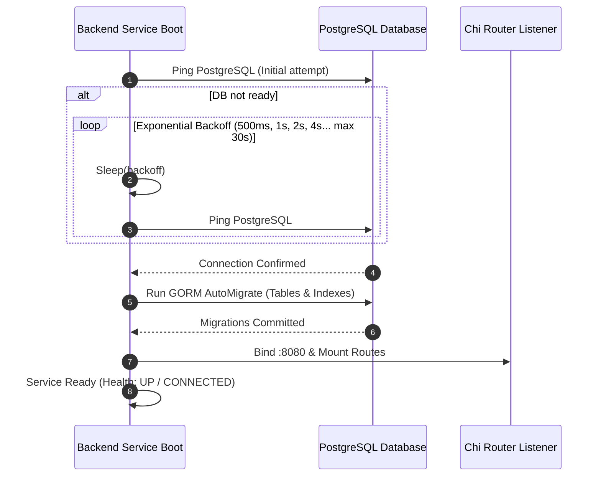

# Reliability Design: Unit `backend`

**Stage**: `nfr-design` (3.3)  
**Unit**: `backend` (`U1`, kind: `service`, directory: `backend`)  
**Lead Agent**: `aidlc-architect-agent`  
**Support Agents**: `aidlc-aws-platform-agent`  
**Date**: 2026-10-16  

---

## 1. Upstream Traceability & Scope

This specification formalizes the concurrency synchronization, fault tolerance, transaction boundaries, startup healing, and health check designs satisfying `reliability-requirements.md` (`NFR4.1`–`NFR4.5`):
- `reliability-requirements.md`: 99.5% SLO, exponential startup backoff, fail-fast rollback.
- `nfr-design-questions.md`: Q1 confirmed Project-Scoped Ingestion Synchronization + DB Transaction Locking.

---

## 2. Ingestion Concurrency & Project Isolation Pattern (`NFR4.3`)

Per Question Q1 decision, concurrent snapshot CSV uploads are isolated at the project boundary:

```
Upload Stream A (PRJ-001) ──┐
                            ├─> [ Project Lock Registry ] ──> Acquire Lock(PRJ-001) ──> Run Ingest
Upload Stream B (PRJ-002) ──┤   (sync.Map / Mutex Map)   ──> Acquire Lock(PRJ-002) ──> Run Ingest (Parallel!)
                            │
Upload Stream C (PRJ-001) ──┘   (Conflict detected!)     ──> Reject HTTP 409 Conflict immediately
```

### Architectural Implementation Pattern:
```go
type IngestionCoordinator struct {
    mu    sync.Mutex
    locks map[string]struct{} // Set of currently active project_ids
}

func (c *IngestionCoordinator) TryAcquire(projectID string) bool {
    c.mu.Lock()
    defer c.mu.Unlock()
    if _, active := c.locks[projectID]; active {
        return false // Lock already held for this project
    }
    c.locks[projectID] = struct{}{}
    return true
}

func (c *IngestionCoordinator) Release(projectID string) {
    c.mu.Lock()
    defer c.mu.Unlock()
    delete(c.locks, projectID)
}
```

- **Behavior**:
  - Independent projects (`PRJ-001` vs `PRJ-002`) run concurrently with full thread safety.
  - Overlapping uploads for the *same* project are rejected with HTTP 409 (`"Ingestion batch already in progress for project PRJ-001"`), preventing concurrent state write conflicts.

---

## 3. Startup Resilience & Migration Lifecycle (`NFR4.4`)



- **Database Polling**: Loops up to 30s with exponential backoff (capped at 4s per attempt).
- **Migration Barrier**: HTTP listener does not open until all database migrations succeed.

---

## 4. Fail-Fast Transaction Rollback Mechanics (`NFR4.3`)

The ingestion pipeline encapsulates all mutations inside an explicit transaction block:

```go
func (s *IngestionService) ProcessBatch(ctx context.Context, batch *IngestionBatch, rows []Row) error {
    tx := s.db.WithContext(ctx).Begin()
    defer func() {
        if r := recover(); r != nil {
            tx.Rollback()
            panic(r)
        }
    }()

    if err := s.executeDeltaIngest(tx, batch, rows); err != nil {
        tx.Rollback() // Strict fail-fast all-or-nothing
        return err
    }

    return tx.Commit().Error
}
```

---

## 5. Health Check & Readiness Probe Architecture (`NFR4.5`)

Mounted at `GET /api/v1/health`:
- Performs a live ping against PostgreSQL using a 1-second timeout context:
  ```go
  ctx, cancel := context.WithTimeout(r.Context(), 1*time.Second)
  defer cancel()
  err := sqlDB.PingContext(ctx)
  ```
- If ping succeeds: Return HTTP 200 with `database: CONNECTED`.
- If ping fails: Return HTTP 503 with `database: DISCONNECTED`.

