# Frontend Components Specification: Unit `frontend`

**Stage**: `functional-design` (3.1)  
**Unit**: `frontend` (`U2`, kind: `ui`, directory: `frontend`)  
**Lead Agent**: `aidlc-architect-agent`  
**Support Agent**: `aidlc-developer-agent`  
**Date**: 2026-10-19  

---

## 1. Upstream Traceability & Component Architecture

This component architecture defines the React 18 component tree, prop signatures, state boundaries, and API integration layers for the corporate document management system dashboard (`frontend` / `U2`), strictly tracing to:
- [Requirements Specification (2.3)](file:///c:/Users/user/Desktop/SCG/eps-dashboard/aidlc/spaces/default/intents/261016-doc-dashboard/inception/requirements-analysis/requirements.md): `FR2` (5 QA/QC Pillars), `FR3` (Scorecards & Delinquency), `FR4` (Comparative Matrix & Accordions), `FR5` (Trend View), and `NFR1`–`NFR5`.
- [Refined Mockups (2.5)](file:///c:/Users/user/Desktop/SCG/eps-dashboard/aidlc/spaces/default/intents/261016-doc-dashboard/inception/refined-mockups/mockups.md): Screen 1 (QA/QC Overview), Screen 2 (Trend Analytics), Screen 3 (CSV Ingestion), Global Tabs, and Dark-Navy Header.
- [Contract Summary (2.8)](file:///c:/Users/user/Desktop/SCG/eps-dashboard/aidlc/spaces/default/intents/261016-doc-dashboard/inception/contract-design/contract-summary.md): OpenAPI endpoints and Universal Envelope.
- [Frontend Standards & Tech Stack](file:///c:/Users/user/Desktop/SCG/eps-dashboard/aidlc/spaces/default/knowledge/aidlc-shared/frontend-standards.md): 5-layer design hierarchy, TanStack Query, Tailwind CSS, Lucide Icons, Recharts, and English-only UI.

---

## 2. Component Hierarchy & Layering

```mermaid
flowchart TD
    subgraph L3["Layer 3: Layout Shell"]
        SHELL["DashboardShell (Root layout container, navigation header, tab router slot)"]
        HEADER["HeaderNav (Corporate dark-navy header #152444, logo, health heartbeat, CSV upload CTA)"]
        TABS["NavigationTabs (3 Global Tabs: QA/QC Overview, Trend Analytics, CSV Ingestion)"]
        FILTERS["GlobalFilterBar (Project selector dropdown, snapshot date picker, quick presets)"]
        SHELL --> HEADER
        SHELL --> TABS
        SHELL --> FILTERS
    end

    subgraph L2["Layer 2: Composed Feature Organisms"]
        subgraph S1["Screen 1: QA/QC Overview"]
            TOPBAR["TopbarKpiCards (Macro totals, 5 QA/QC category summary cards)"]
            KPIDETAIL["CategoryDetailGrid (Expanding drawer showing project contributions)"]
            SEARCH["SearchToolbar (200ms debounced input, column sorting controls)"]
            MATRIX["ProjectMatrixTable (Multi-project comparative list/card container)"]
            PCARD["ProjectCard (Project status badge, 5 pillar progress bars, delinquency alerts)"]
            ACCORDION["DisciplineAccordion (ME/CE/EE breakdown, drawing type chips, aging stats)"]
            TOPBAR --> KPIDETAIL
            MATRIX --> PCARD
            PCARD --> ACCORDION
        end

        subgraph S2["Screen 2: Trend Analytics"]
            PRESETS["PresetToolbar (30D, 90D, 180D, 1Y, All Time presets + custom date inputs)"]
            METRICSEL["MetricSelector (Total, Approved, In-Review, Overdue radio filters)"]
            PROJSEL["ProjectSelectorDropdown (Multi-select checkboxes, 8+16 deterministic color badges)"]
            TREND["HistoricalTrendChart (Recharts canvas, smooth bezier lines, crosshair vertical line)"]
            TOOLTIP["TrendTooltip (Unified multi-project comparative tooltip on hover)"]
            TREND --> TOOLTIP
        end

        subgraph S3["Screen 3: CSV Ingestion"]
            DROPZONE["CsvUploadZone (Drag-and-drop file upload zone, progress bar, file validator)"]
            BATCHTABLE["IngestionHistoryTable (Recent batch ledger: batch ID, target, deltas, status)"]
            ERRMODAL["IngestionErrorModal (Corrupted line diagnostics and timestamp conflict warnings)"]
            DROPZONE --> ERRMODAL
        end

        SHELL --> TOPBAR
        SHELL --> SEARCH
        SHELL --> MATRIX
        SHELL --> PRESETS
        SHELL --> METRICSEL
        SHELL --> PROJSEL
        SHELL --> TREND
        SHELL --> DROPZONE
        SHELL --> BATCHTABLE
    end

    subgraph L1["Layer 1: UI Primitives & Interactive States"]
        SKELETON["SkeletonShimmer (Zero-CLS table, card, and chart loading states)"]
        EMPTY["EmptyState (Zero-data container with Lucide icon, explanatory text, CTA)"]
        ERROR["ErrorAlert (Accessible error container with envelope description and Retry button)"]
        BADGE["StatusBadge / DelinquencyChip (.chip-blink pulsing animation, trend indicator arrows)"]
        PROGRESS["PillarProgressBar (Approval progress bar colored by 5 QA/QC pillar palette)"]

        PCARD --> SKELETON
        PCARD --> BADGE
        PCARD --> PROGRESS
        TREND --> SKELETON
        TREND --> EMPTY
        TREND --> ERROR
        BATCHTABLE --> SKELETON
        BATCHTABLE --> EMPTY
    end
```



---

## 3. Detailed Component Contracts & Prop Types

### 3.1 Global Navigation & Shell Components

#### `DashboardShell`
- **Purpose**: Root application frame providing theme provider, query client provider, header, tab bar, and active view switcher.
- **Props**: None (Root component).
- **Internal State**: `activeTab: 'overview' | 'trends' | 'ingest'`, `selectedProjects: string[]`, `snapshotDate: string`.

#### `HeaderNav`
- **Purpose**: Corporate header bar styled with `#152444` background.
- **Props**:
  ```typescript
  interface HeaderNavProps {
    onUploadClick: () => void;
    systemHealth: 'healthy' | 'degraded' | 'offline';
  }
  ```

#### `NavigationTabs`
- **Purpose**: Switches primary view between Overview, Trends, and Ingestion.
- **Props**:
  ```typescript
  interface NavigationTabsProps {
    activeTab: 'overview' | 'trends' | 'ingest';
    onTabChange: (tab: 'overview' | 'trends' | 'ingest') => void;
  }
  ```

---

### 3.2 Screen 1 Components (QA/QC Comparative Overview)

#### `TopbarKpiCards`
- **Purpose**: Renders top-level portfolio volume metrics and 5 QA/QC pillar summary cards.
- **Props**:
  ```typescript
  interface TopbarKpiCardsProps {
    summary: GlobalSummaryResult | null;
    isLoading: boolean;
    selectedCategory: QaQcCategoryKey | null;
    onCategoryClick: (category: QaQcCategoryKey) => void;
  }
  ```

#### `ProjectCard` & `ProjectMatrixTable`
- **Purpose**: Renders comparative project health, status badges (`ON TRACK`, `ATTENTION`, `CRITICAL`), and 5 QA/QC pillar progress rows.
- **Props**:
  ```typescript
  interface ProjectCardProps {
    project: ProjectMatrixItem;
    onExpandDiscipline: (projectId: string) => void;
    isExpanded: boolean;
    disciplineData?: ProjectDisciplinesResult;
    isDisciplineLoading?: boolean;
  }
  ```

#### `DisciplineAccordion`
- **Purpose**: Displays collapsible breakdown of ME/CE/EE engineering drawing statuses, drawing availability badges, and average aging days.
- **Props**:
  ```typescript
  interface DisciplineAccordionProps {
    projectId: string;
    disciplines: Record<'ME' | 'CE' | 'EE', DisciplineStats>;
    drawingTypes: string[];
    averageAgingDays: number;
  }
  ```

---

### 3.3 Screen 2 Components (Historical Trend Analytics)

#### `HistoricalTrendChart`
- **Purpose**: High-performance SVG multi-project comparative time-series line chart.
- **Props**:
  ```typescript
  interface HistoricalTrendChartProps {
    data: TrendDataPoint[];
    selectedProjects: string[];
    selectedMetric: 'total' | 'approved' | 'in_review' | 'overdue';
    colorMap: Record<string, string>;
    isLoading: boolean;
    isError: boolean;
    onRetry: () => void;
  }
  ```

#### `PresetToolbar`
- **Purpose**: Preset time range selector buttons and custom date inputs.
- **Props**:
  ```typescript
  interface PresetToolbarProps {
    activePreset: '30D' | '90D' | '180D' | '1Y' | 'ALL';
    onPresetChange: (preset: '30D' | '90D' | '180D' | '1Y' | 'ALL') => void;
    customRange: { from?: string; to?: string };
    onCustomRangeChange: (range: { from?: string; to?: string }) => void;
  }
  ```

---

### 3.4 Screen 3 Components (Operational CSV Ingestion)

#### `CsvUploadZone`
- **Purpose**: Drag-and-drop CSV snapshot file uploader with progress and feedback.
- **Props**:
  ```typescript
  interface CsvUploadZoneProps {
    onUploadSuccess: (batch: IngestionBatchSummary) => void;
    availableProjects: Array<{ id: string; name: string }>;
  }
  ```

#### `IngestionHistoryTable`
- **Purpose**: Table listing historical batch snapshots with execution times and deltas.
- **Props**:
  ```typescript
  interface IngestionHistoryTableProps {
    batches: IngestionBatchSummary[];
    isLoading: boolean;
  }
  ```

---

## 4. Visual Styles, Tokens & Animations

1. **5 QA/QC Pillar Color Tokens**:
   - Baseline Drawings: `#2f6fce` (Tailwind `blue-600`)
   - Control: `#12a4a0` (Tailwind `teal-600`)
   - Corrective Actions: `#ee8a1f` (Tailwind `amber-600`)
   - Change Management: `#26a65b` (Tailwind `emerald-600`)
   - Complete: `#8b5cf6` (Tailwind `purple-600`)
2. **Delinquency Animation**:
   - Class `.chip-blink`: `animation: pulse 1.5s cubic-bezier(0.4, 0, 0.6, 1) infinite;` with bright red border/background.
3. **Typography**:
   - Font family: `'IBM Plex Sans Thai', sans-serif;`. Tabular numbers: `font-feature-settings: "tnum" 1;`.
