# Frontend Components Specification: Unit `frontend`

**Stage**: `functional-design` (3.1)  
**Unit**: `frontend` (`U2`, kind: `ui`, directory: `frontend`)  
**Lead Agent**: `aidlc-architect-agent`  
**Support Agent**: `aidlc-developer-agent`  
**Date**: 2026-10-19  

---

## 1. Upstream Traceability & Architectural Alignment

This frontend component specification formalizes the React 18 component hierarchy, props contracts, state management models, and API integration boundaries for the Document Management System dashboard. It directly implements:
- `unit-of-work.md`: Unit definition for `frontend` (`U2`), enforcing React 18, TypeScript, Tailwind CSS, Lucide React, and Recharts.
- `unit-of-work-story-map.md`: User stories `US2.1` (KPI cards), `US2.2` (Comparative matrix), `US2.3` (Delinquency flagging), `US4.1` (Trend view), `US4.2` (Multi-project overlay), and `US1.1` (CSV upload modal).
- `contract-summary.md`: Inter-unit REST contract endpoints (`/api/v1/health`, `/api/v1/projects/summary`, `/api/v1/projects`, `/api/v1/analytics/trends`, `/api/v1/ingest`).
- `frontend-architecture.md` & `frontend-standards.md`: 5-layer component architecture, 4/8pt spatial rhythm, IBM Plex Sans Thai typography, tabular numbers, and mandatory 4 screen states.

---

## 2. Component Hierarchy & Architectural Layering

```mermaid
flowchart TD
    subgraph L3["Layer 3: Layout Shell"]
        APP["DashboardShell (Root layout container, navigation header, main content slot)"]
        HEADER["HeaderNav (Brand logo, environment badge, health heartbeat, CSV upload trigger)"]
        APP --> HEADER
    end

    subgraph L2["Layer 2: Composed Feature Organisms"]
        TOPBAR["TopbarKpiCards (Macro total volume, 5 QA/QC category summary cards)"]
        KPIDETAIL["CategoryDetailGrid (Expanding collapse panel showing project-level contributions)"]
        MATRIX["ProjectMatrixTable (Tabular comparative grid with site-by-site status)"]
        SEARCH["SearchToolbar (200ms debounced input, URL synchronization via Nuqs)"]
        TREND["HistoricalTrendChart (Recharts canvas, preset window buttons, crosshair tooltip)"]
        PROJSELECT["ProjectSelectorDropdown (Multi-select checkbox popover with color badges)"]
        UPLOAD["CsvUploadModal (Drag-and-drop file upload dialog with progress bar)"]

        APP --> TOPBAR
        TOPBAR --> KPIDETAIL
        APP --> SEARCH
        APP --> MATRIX
        APP --> PROJSELECT
        APP --> TREND
        HEADER --> UPLOAD
    end

    subgraph L1["Layer 1: UI Primitives & Interactive States"]
        SKELETON["TableSkeleton / CardSkeleton (Zero-CLS loading shimmer states)"]
        EMPTY["EmptyState (Illustrated empty zero-data state with CTA)"]
        ERROR["ErrorAlert (Network/server error display with Retry callback)"]
        BADGE["CategoryBadge / DelinquencyChip (.chip-blink pulsing alerts, trend tags)"]

        MATRIX --> SKELETON
        MATRIX --> EMPTY
        MATRIX --> ERROR
        MATRIX --> BADGE
        TREND --> SKELETON
        TREND --> EMPTY
        TREND --> ERROR
    end

    style APP fill:#e3f2fd,stroke:#1565c0,stroke-width:2px,color:#000
    style TOPBAR fill:#e8f5e9,stroke:#2e7d32,stroke-width:2px,color:#000
    style MATRIX fill:#fff3e0,stroke:#e65100,stroke-width:2px,color:#000
    style TREND fill:#ede7f6,stroke:#512da8,stroke-width:2px,color:#000
    style UPLOAD fill:#fce4ec,stroke:#c2185b,stroke-width:2px,color:#000
```



---

## 3. Detailed Component Specifications

### 3.1 `TopbarKpiCards` & `CategoryDetailGrid`
- **Responsibility**: Displays executive macro statistics and category breakdowns for Baseline Drawings, Control (ITP, RFI, ITR), Corrective (NCR, CAR), Change (PCR/FCR, DCR, VOR), and Complete documents.
- **Props & State**:
  ```typescript
  export interface TopbarKpiCardsProps {
    summary: GlobalSummaryData | null;
    isLoading: boolean;
    isError: boolean;
    onRetry: () => void;
  }

  export interface GlobalSummaryData {
    totalDocuments: number;
    activeProjectsCount: number;
    totalOverdueCount: number;
    categories: {
      baseline: CategorySummaryMetric;
      control: CategorySummaryMetric;
      corrective: CategorySummaryMetric;
      change: CategorySummaryMetric;
      complete: CategorySummaryMetric;
    };
  }

  export interface CategorySummaryMetric {
    displayName: string;
    totalCount: number;
    openCount: number;
    closedCount: number;
    overdueCount: number;
    delinquencyRatio: number; // percentage (0.0 - 100.0)
    isCritical: boolean;      // true if delinquencyRatio >= 45.0%
    netChange: 'shrinking' | 'expanding' | 'stable';
    projectBreakdown: Array<{
      projectId: string;
      siteCode: string;
      count: number;
      overdueCount: number;
    }>;
  }
  ```
- **Interaction**: Clicking any category card toggles the `CategoryDetailGrid` accordion panel smoothly (`transition-all duration-300`). Clicking an open card or outside closes the panel.

---

### 3.2 `SearchToolbar` & `ProjectMatrixTable`
- **Responsibility**: Renders comparative project matrix across all 5 QA/QC categories and overdue documents, with real-time debounced client-side filtering and Nuqs URL query string synchronization.
- **Props & State**:
  ```typescript
  export interface ProjectMatrixTableProps {
    projects: ProjectMatrixRow[];
    searchQuery: string;
    onSearchChange: (query: string) => void;
    isLoading: boolean;
    isError: boolean;
    onRetry: () => void;
  }

  export interface ProjectMatrixRow {
    projectId: string;
    siteCode: string;
    totalDocuments: number;
    baselineCount: number;
    controlMetrics: {
      total: number;
      open: number;
      closed: number;
      overdue: number;
      pendingRatio: number;
      isCritical: boolean; // >= 45% -> .chip-blink
      trend: 'shrinking' | 'expanding' | 'stable';
    };
    correctiveMetrics: {
      total: number;
      open: number;
      closed: number;
      overdue: number;
      averageAgingDays: number;
      pendingRatio: number;
      isCritical: boolean;
      trend: 'shrinking' | 'expanding' | 'stable';
    };
    changeMetrics: {
      total: number;
      open: number;
      closed: number;
      overdue: number;
      pendingRatio: number;
      isCritical: boolean;
      trend: 'shrinking' | 'expanding' | 'stable';
    };
    completeCount: number;
    overdueCount: number;
  }
  ```
- **Search & Filter Flow**: User types in `#searchInput`. Nuqs updates URL to `?search=PRJ-01` with 200ms debounce. Table filters rows where `projectId.toLowerCase().includes(query)` or `siteCode.toLowerCase().includes(query)`.
- **Delinquency Highlighting**: Rows with `isCritical: true` render `.chip-blink` pulsing badges (`animate-pulse border-amber-500 bg-amber-50/50`).

---

### 3.3 `HistoricalTrendChart` & `ProjectSelectorDropdown`
- **Responsibility**: Renders multi-project time-series curves over full project lifecycles or scaled preset windows (`All Time`, `1 Year`, `6 Months`, `3 Months`) using Recharts SVG LineChart.
- **Props & State**:
  ```typescript
  export interface HistoricalTrendChartProps {
    availableProjects: Array<{ projectId: string; siteCode: string }>;
    selectedProjectIds: string[];
    onToggleProject: (projectId: string) => void;
    timePreset: 'all_time' | '1_year' | '6_months' | '3_months';
    onTimePresetChange: (preset: 'all_time' | '1_year' | '6_months' | '3_months') => void;
    dataPoints: DailyTrendDataPoint[];
    isLoading: boolean;
    isError: boolean;
    onRetry: () => void;
  }

  export interface DailyTrendDataPoint {
    date: string; // ISO date 'YYYY-MM-DD'
    [projectId: string]: string | number; // document count for each active project
  }
  ```
- **Categorical Color Palette (8+16 Deterministic Scheme)**:
  - Base 8 Golden Hues: `#1D4ED8` (Blue), `#059669` (Emerald), `#D97706` (Amber), `#DC2626` (Red), `#7C3AED` (Violet), `#0891B2` (Cyan), `#EA580C` (Orange), `#4F46E5` (Indigo).
  - Extended 16 Hues: Generated via deterministic HSL rotation with constant 65% lightness and 70% saturation.
  - Colors are allocated by stable project ID hash, ensuring curve color stability when projects are added or deselected.
- **Synchronized Crosshair Tooltip**: Uses `<Tooltip content={<UnifiedCustomTooltip />} />` displaying all selected project metrics aligned side-by-side with tabular figures at the hovered date timestamp.

---

### 3.4 `CsvUploadModal`
- **Responsibility**: Accessible modal dialog enabling operational project engineers to upload daily `AUTOEMAIL_FILE_06_*.csv` snapshots with drag-and-drop support, client validation, progress visualization, and ingestion outcome feedback.
- **Validation Rules**:
  - File extension must be `.csv`.
  - MIME type must be `text/csv`, `application/vnd.ms-excel`, or `text/plain`.
  - Max file size $\le 10,485,760\text{ bytes}$ (10MB).
- **Upload States**:
  - `Idle`: Drag-and-drop dropzone with file picker button.
  - `Validating`: Client-side schema check.
  - `Uploading`: Progress bar ($0\% \rightarrow 100\%$) while transmitting multipart stream.
  - `Success`: Ingestion summary toast (new rows, updated revisions, delta count, or duplicate notification).
  - `Conflict`: HTTP 409 alert if snapshot has out-of-order date regression.
  - `Error`: HTTP 400/500 alert displaying specific validation diagnostics.

---

## 4. Mandatory Screen States Implementation

Every primary component renders all 4 standard interactive screen states with zero cumulative layout shift (CLS):

| State | Component Manifestation | Visual Characteristics | User Recovery Action |
|:---|:---|:---|:---|
| **1. Loading** | `TableSkeleton` / `ChartSkeleton` | Pulse shimmer (`animate-pulse`) mirroring exact header, column widths, and card layout | Automatic transition on request resolution |
| **2. Empty** | `EmptyState` | Centered dashed border container, folder/search icon, clear descriptive title | "Clear Search Filters" or "Upload CSV Snapshot" CTA button |
| **3. Error** | `ErrorAlert` | Destructive banner with alert triangle icon, sanitized diagnostic text | "Retry Request" button triggering query invalidation |
| **4. Success** | Populated Views | Complete data presentation, responsive table layout, interactive Recharts curves | Normal navigation and filtering interactions |

---

## 5. API Client & Transport Layer Integration

The frontend client consumes the backend service through typed TanStack Query / fetch hooks:

| API Route | HTTP Method | React Hook | Component Consumer | Cache Policy |
|:---|:---|:---|:---|:---|
| `/api/v1/health` | `GET` | `useHealthCheck()` | `HeaderNav` | 30s polling, staleTime 15s |
| `/api/v1/projects/summary` | `GET` | `useGlobalSummary()` | `TopbarKpiCards`, `CategoryDetailGrid` | staleTime 60s, refetch on upload |
| `/api/v1/projects` | `GET` | `useProjectMatrix(search)` | `ProjectMatrixTable` | staleTime 30s, keepPreviousData |
| `/api/v1/analytics/trends` | `GET` | `useHistoricalTrends(projects, preset)` | `HistoricalTrendChart` | staleTime 120s, cache by params |
| `/api/v1/ingest` | `POST` | `useUploadSnapshot()` | `CsvUploadModal` | Invalidates `projects` and `summary` on success |

