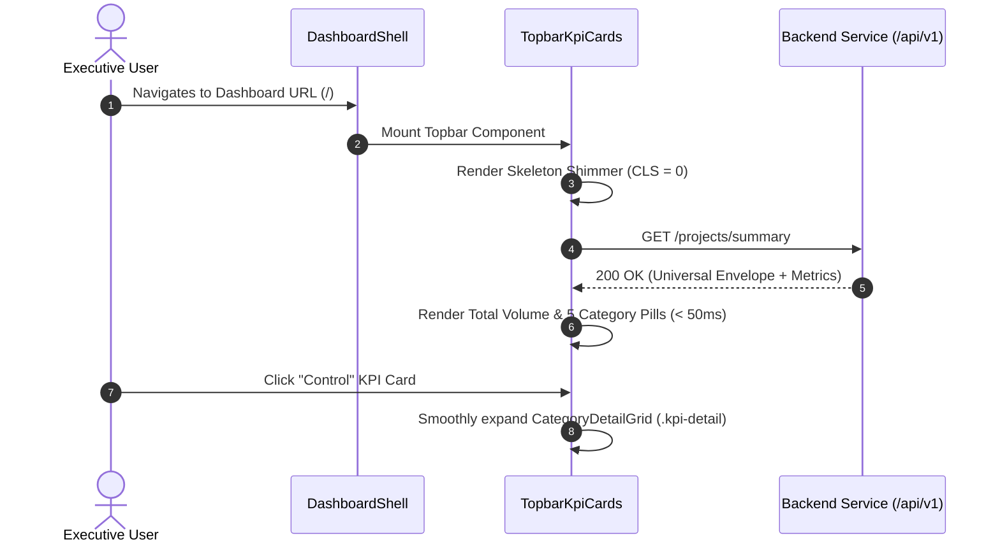
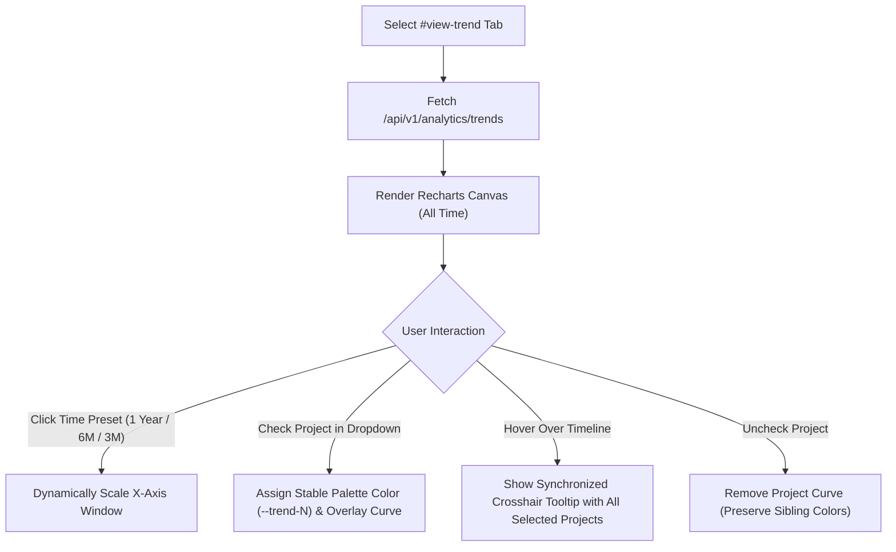
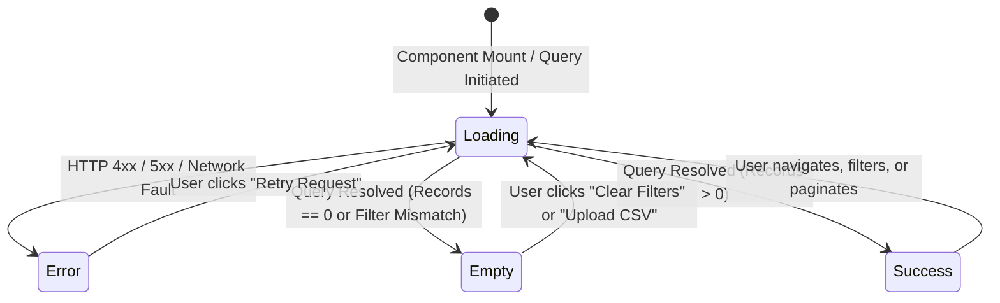
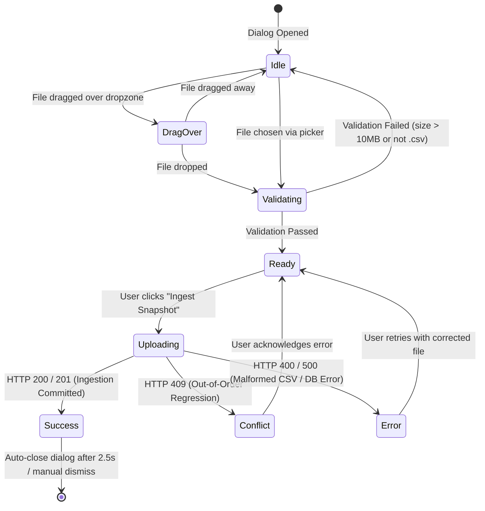

# Functional Design Specification: Unit `frontend`

**Stage**: `functional-design` (3.1)  
**Unit**: `frontend` (`U2`, kind: `ui`, directory: `frontend`)  
**Lead Agent**: `aidlc-architect-agent`  
**Support Agent**: `aidlc-developer-agent`  
**Date**: 2026-10-19  

---

## 1. Upstream Traceability & Inputs

This behavioural and functional specification establishes the authoritative source of truth for user interaction workflows, application state machines, and dynamic screen transitions for the React 18 single-page application (`frontend` / `U2`), directly tracing from:
- `unit-of-work.md`: Unit definition, technology foundation (React 18, TypeScript, Tailwind CSS, Lucide Icons, Recharts), and scope exclusions.
- `unit-of-work-story-map.md`: Story allocations for `US2.1` (KPI cards), `US2.2` (Comparative matrix), `US2.3` (Delinquency alerts), `US4.1` (Trend canvas), `US4.2` (Multi-project overlay), and `US1.1` (CSV upload UI).
- `requirements.md`: Functional and non-functional requirements `FR2.1`–`FR2.3`, `FR3.1`–`FR3.4`, `FR4.1`, `FR4.3`, `FR5.1`–`FR5.5`, and `NFR1`–`NFR5`.
- `components.md`: Domain architecture allocating `DashboardUIClient`.
- `contract-summary.md`: Inter-unit RESTful contract defining OpenAPI 3.0 endpoints (`/health`, `/projects/summary`, `/projects`, `/analytics/trends`, `/ingest`) and the universal envelope.

---

## 2. Interactive Workflows Specification

### 2.1 Workflow 1: Dashboard Initialization & Macro Overview
- **Actor**: Executive Viewer / Project Director
- **Preconditions**: User navigates to dashboard root URL (`/`).
- **Main Success Scenario**:
  1. The application mounts the `DashboardShell` layout with `HeaderNav`.
  2. Simultaneously initiates asynchronous queries to `/api/v1/health` and `/api/v1/projects/summary`.
  3. `TopbarKpiCards` renders loading shimmer skeletons (`CardSkeleton`) with zero cumulative layout shift (CLS $< 0.1$).
  4. Upon receiving the JSON envelope from `/api/v1/projects/summary` in $< 50\text{ ms}$, the topbar renders total document count and 5 category pills:
     - Baseline Drawings (`FR2.1`)
     - Control (`ITP`, `RFI`, `ITR`) (`FR3.1`)
     - Corrective (`NCR`, `CAR`) (`FR3.1`)
     - Change (`PCR/FCR`, `DCR`, `VOR`) (`FR3.1`)
     - Complete (`50:RETURN`) (`FR2.1`)
  5. If an executive clicks any category card, the `CategoryDetailGrid` expands beneath the topbar displaying project-level volume contributions for that specific category.

---

### 2.2 Workflow 2: Comparative Matrix Navigation, Search & Pagination
- **Actor**: Project Engineer / Document Controller
- **Preconditions**: User views the Comparative Overview tab.
- **Main Success Scenario**:
  1. The table requests `/api/v1/projects` with initial pagination parameters (`page=1`, `page_size=20`).
  2. `ProjectMatrixTable` renders `TableSkeleton` while data is in flight.
  3. Upon response resolution, renders project rows side-by-side with Site Code, Project ID, Baseline, Control, Corrective, Change, and Overdue counts.
  4. User types `"PRJ-01"` into `#searchInput`.
  5. The `SearchToolbar` debounces user input by 200ms and filters project rows client-side.
  6. Nuqs synchronizes the URL query string to `/?search=PRJ-01` without triggering a full page reload.
  7. If zero projects match the query, `EmptyState` displays an illustrated empty container with a "Clear Search Filters" CTA.

---

### 2.3 Workflow 3: Delinquency Inspection & Visual Alerting
- **Actor**: Quality Lead / Executive Auditor
- **Preconditions**: Comparative matrix data is rendered.
- **Main Success Scenario**:
  1. For each project row, the table computes the pending ratio for actionable categories ($\frac{\text{Open}}{\text{Open}+\text{Closed}} \times 100$).
  2. If the pending ratio is $\ge 45.0\%$, the cell is tagged as critical and applies the `.chip-blink` CSS class (`animate-pulse border-amber-500 bg-amber-50/50`).
  3. If overdue documents exist (`DUEDATE < anchor_date` and not returned), the Overdue column renders an amber/red overdue tag with the count.
  4. The status pill renders a directional week-over-week indicator:
     - $\blacktriangledown$ Green downward arrow indicating shrinking backlog.
     - $\blacktriangle$ Red upward arrow indicating expanding backlog.
     - $-$ Neutral dash indicating stable backlog.

---

### 2.4 Workflow 4: Historical Time-Series Scaling & Multi-Project Overlay
- **Actor**: Portfolio Manager / Planning Director
- **Preconditions**: User navigates to Historical Trend tab (`#view-trend`).
- **Main Success Scenario**:
  1. The trend view requests `/api/v1/analytics/trends` for default projects across the full historical lifetime.
  2. Recharts renders continuous bezier curves in $< 50\text{ ms}$ upon data arrival.
  3. User clicks the `1 Year` preset button on `PresetToolbar`.
  4. The canvas dynamically re-scales horizontal X-axis date ticks to the 365-day window without layout jitter.
  5. User opens `ProjectSelectorDropdown` and checks Project B alongside Project A.
  6. The canvas assigns a distinct color from the 8+16 deterministic categorical colorway and overlays Project B's curve onto the shared canvas.
  7. When hovering anywhere along the timeline, a unified crosshair vertical line appears, and a unified tooltip displays the document counts of all selected projects side-by-side.
  8. User unchecks Project A; Project A's curve is cleanly removed while Project B retains its assigned color.

---

### 2.5 Workflow 5: Drag-and-Drop CSV Ingestion & Feedback
- **Actor**: Operational Document Controller
- **Preconditions**: User clicks "Upload Snapshot CSV" in `HeaderNav`.
- **Main Success Scenario**:
  1. Accessible modal dialog (`CsvUploadModal`) opens with backdrop focus trap.
  2. User drags and drops `AUTOEMAIL_FILE_06_20261016.csv` into the dropzone (or selects via native file picker).
  3. Client validates that file extension is `.csv` and size $\le 10\text{ MB}$.
  4. User clicks "Confirm & Ingest"; the modal displays a progressive indeterminate upload bar.
  5. The client submits a `multipart/form-data` POST request to `/api/v1/ingest`.
  6. Upon receiving HTTP 200/201, the modal displays a success summary toast displaying ingested row counts, active revision updates, and delta change logs.
  7. The application automatically invalidates query caches for `/projects/summary` and `/projects`, updating dashboard metrics immediately.

---

## 3. Application State Machines

### 3.1 View Screen State Machine
Every primary view, data table, and analytics chart strictly implements the 4 mandatory screen states:

- **Loading State**: Renders dimensional skeleton pulses with identical row heights and column widths (`animate-pulse`). Never causes Cumulative Layout Shift ($CLS < 0.1$).
- **Empty State**: Renders centered dashed container with contextual icon, explanatory description, and primary recovery action.
- **Error State**: Renders alert banner with error message and accessible "Retry" button.
- **Success State**: Renders complete interactive data grid or chart canvas.

---

### 3.2 CSV Upload Dialog State Machine

---

## 4. Derived Rules Summary View

The following table summarizes the business rules governing this unit's functional execution, derived from [Business Rules Specification](rules.md):

| Rule ID | Statement Summary | Target Component | Upstream Traceability |
|:---|:---|:---|:---|
| **`BR7.1`** | Topbar renders total count and 5 QA/QC category pills in $< 50\text{ ms}$ upon data receipt | `TopbarKpiCards` | `FR2.1`, `FR2.3`, `NFR1.1` |
| **`BR7.2`** | Topbar KPI metrics reflect latest active revisions only, excluding superseded historical revisions | `TopbarKpiCards` | `FR2.1`, `FR1.5` |
| **`BR7.3`** | Clicking interactive KPI cards expands `.kpi-detail` collapse panel with project contributions | `TopbarKpiCards` | `FR2.3` |
| **`BR8.1`** | Comparative matrix renders projects side-by-side across all 5 categories and overdue counts | `ProjectMatrixTable` | `FR4.1`, `FR4.3`, `NFR5.1` |
| **`BR8.2`** | Search toolbar filters matrix rows client-side with 200ms debounce and synchronizes to URL via Nuqs | `SearchToolbar` | `FR4.3`, `NFR5.1` |
| **`BR8.3`** | All views and tables explicitly handle all 4 mandatory screen states with zero CLS | `ProjectMatrixTable` | `NFR5.1` |
| **`BR9.1`** | Overdue documents increment overdue counter and display clear visual status tags | `OverdueBadge` | `FR2.2`, `FR3.2` |
| **`BR9.2`** | Categories with pending delinquency ratio $\ge 45\%$ trigger pulsing visual alert (`.chip-blink`) | `DelinquencyChip` | `FR3.3`, `FR3.4` |
| **`BR9.3`** | Week-over-week net backlog changes render directional trend tag ($\blacktriangledown$ green / $\blacktriangle$ red / $-$) | `TrendTag` | `FR3.4` |
| **`BR10.1`** | Historical Trend view queries `project_daily_metrics` and renders Recharts canvas in $< 50\text{ ms}$ | `HistoricalTrendChart` | `FR5.1`, `FR5.5`, `NFR1.4` |
| **`BR10.2`** | Time range preset buttons dynamically scale horizontal X-axis date ticks to preset windows | `PresetToolbar` | `FR5.5` |
| **`BR10.3`** | Multi-project selection assigns distinct deterministic 8+16 categorical colors to project curves | `ProjectSelectorDropdown` | `FR5.2`, `FR5.3` |
| **`BR10.4`** | Hovering timeline displays unified crosshair line and tooltip with all selected projects side-by-side | `ChartTooltip` | `FR5.4` |
| **`BR10.5`** | Unchecking a project removes its curve cleanly while preserving color assignments of remaining curves | `ProjectSelectorDropdown` | `FR5.2`, `FR5.3` |

