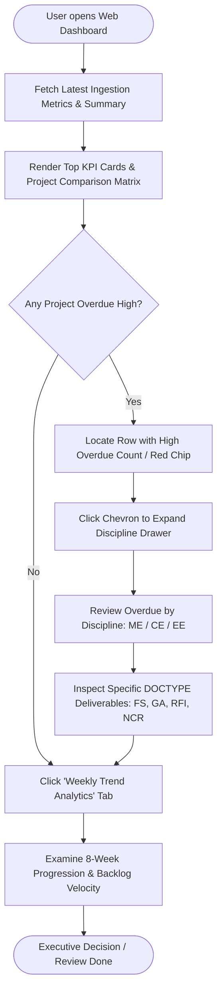
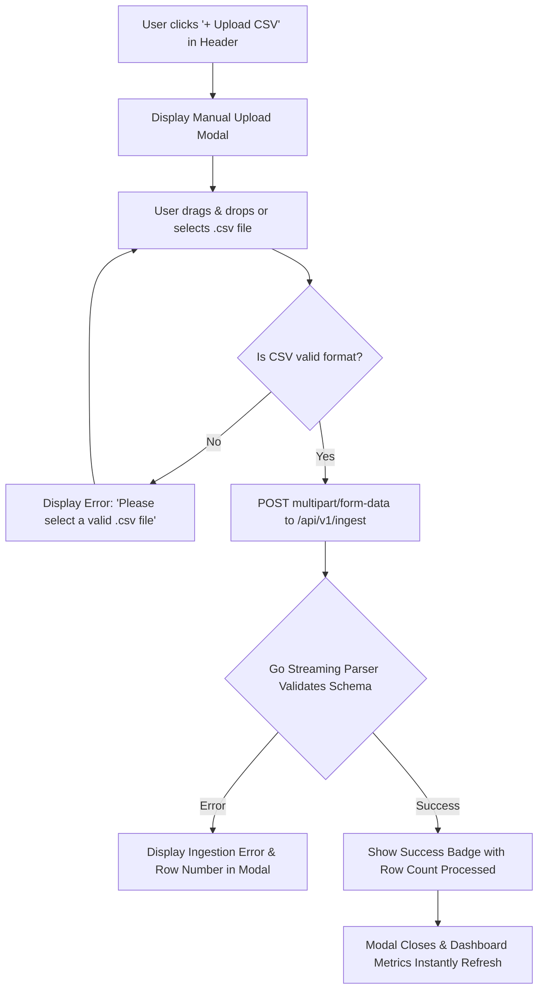
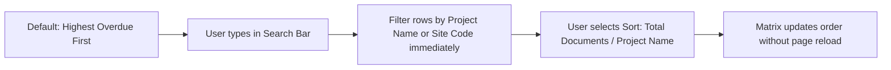

# User Flow & Interaction Specification

## Context & Upstream Traceability
This user flow details the paths, interaction states, and error handling for executive decision-makers and administrators, derived from `intent-statement.md`, `scope-document.md`, `intent-backlog.md`, and `wireframes.md`.

---

## 1. Executive Happy Path (Daily Monitoring & Overdue Drilldown)

---

## 2. Ingestion Path (Manual Snapshot Upload)

---

## 3. Search & Sort State Transitions

