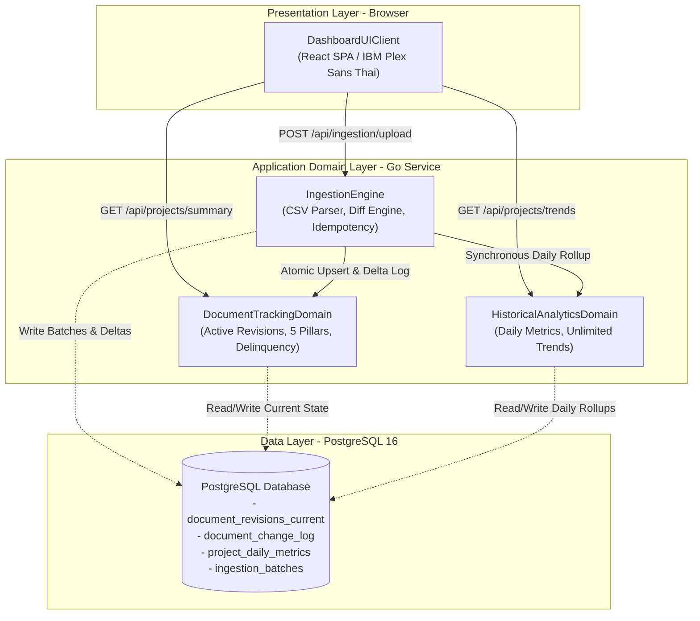

# Component Catalogue & Domain Architecture

**Stage**: `domain-design` (2.6)  
**Intent**: `261016-doc-dashboard`  
**Lead Agent**: `aidlc-architect-agent`  
**Date**: 2026-10-16  

---

```yaml
components:
  - name: IngestionEngine
    summary: Ingests raw CSV exports, verifies idempotency, performs in-memory diffing, and executes atomic state updates.
    behaviour: >
      Streams CSV rows using encoding detection (UTF-8, ASCII), computes SHA-256 batch checksums to reject duplicate uploads, checks chronological snapshot dates to prevent stale overwrites, loads active revisions into memory, identifies delta changes, upserts current document revisions, writes audit change records, and triggers synchronous daily rollup calculations in a single atomic database transaction.
    responsibilities:
      - CSV parsing and header validation
      - Upload idempotency via SHA-256 hash tracking
      - In-memory diff calculation against current active documents
      - Atomic transaction orchestration across storage tables
    depends_on:
      - component: DocumentTrackingDomain
        interaction: Upserts active document revisions and logs delta changes
        style: sync
      - component: HistoricalAnalyticsDomain
        interaction: Computes and stores daily metric rollups
        style: sync
    dependents:
      - component: DashboardUIClient
        interaction: Invoked via multipart/form-data CSV upload endpoint
    external_dependencies:
      - name: PostgreSQL
        kind: database
        purpose: Stores ingestion batch records, current revisions, delta logs, and daily metrics
    entities:
      - name: IngestionBatch
        identifier: batchId
        attributes: [batchId, projectId, snapshotDate, fileSha256, totalRows, deltasUpdated, skippedUnchanged, status, createdAt]

  - name: DocumentTrackingDomain
    summary: Manages live document state, 5 QA/QC category classification, delinquency evaluations, and project summaries.
    behaviour: >
      Maintains the single source of truth for active documents in document_revisions_current without historical snapshot duplication. Categorizes documents into the 5 QA/QC lifecycle pillars (Baseline, Control, Corrective, Change, Complete) based on document code patterns and metadata. Evaluates overdue status using due dates and return dates against the current snapshot date. Computes real-time % Pending delinquency ratios and returns project health scorecards.
    responsibilities:
      - Active document revision state persistence and retrieval
      - 5 QA/QC lifecycle category classification
      - Due date vs Return date overdue delinquency evaluation
      - Project-level aggregate KPI computation (total, approved, in-review, overdue)
    depends_on: []
    dependents:
      - component: IngestionEngine
        interaction: Receives upsert batches and delta change logs during ingestion
      - component: DashboardUIClient
        interaction: Serves comparative project summaries and scorecard data
    external_dependencies:
      - name: PostgreSQL
        kind: database
        purpose: Stores document_revisions_current and document_change_log tables
    entities:
      - name: DocumentRevision
        identifier: revisionKey
        attributes: [revisionKey, projectId, docId, revId, title, discipline, docType, qaCategory, lastStatus, retCode, dueDate, returnDate, isOverdue, overdueDays, commentList, updatedAt]
      - name: DocumentChangeEvent
        identifier: eventId
        attributes: [eventId, projectId, docId, revId, action, fieldName, oldValue, newValue, changedAt]
        references:
          - entity: DocumentRevision
            owned_by: DocumentTrackingDomain
            relationship: Each change event describes a mutation to one DocumentRevision

  - name: HistoricalAnalyticsDomain
    summary: Owns daily rollup aggregations and multi-project historical time-series trend queries.
    behaviour: >
      Computes and writes exactly one aggregate summary row per project per day into project_daily_metrics during the daily ingestion run. Serves fast, indexed time-series queries spanning the full historical project lifecycle without row-level joins. Computes week-over-week net backlog changes, category distributions, and formats multi-project comparative trend streams for chart rendering.
    responsibilities:
      - Daily rollup metric aggregation and persistence
      - Historical time-series query execution across unlimited date ranges
      - Multi-project comparative dataset assembly
      - Week-over-week variance and velocity calculations
    depends_on: []
    dependents:
      - component: IngestionEngine
        interaction: Receives daily summary data during ingestion transaction
      - component: DashboardUIClient
        interaction: Serves historical trend streams and comparative time-series data
    external_dependencies:
      - name: PostgreSQL
        kind: database
        purpose: Stores project_daily_metrics rollup table with index on (project_id, date)
    entities:
      - name: ProjectDailyMetric
        identifier: metricId
        attributes: [metricId, projectId, metricDate, totalDocs, approvedCount, inReviewCount, overdueCount, baselineCount, controlCount, correctiveCount, changeCount, completeCount, createdAt]

  - name: DashboardUIClient
    summary: React SPA providing comparative scorecards, Recharts trend curves, and CSV upload portal.
    behaviour: >
      Renders the 3-screen corporate document dashboard using IBM Plex Sans Thai typography and Tailwind CSS. Maintains client-side state across tabs. Renders multi-project comparative health cards across the 5 QA/QC category pillars. Renders interactive multi-line charts with persistent 8-color palette, 16-color extended palette, and stroke-dash fallbacks for >8 projects. Handles file drag-and-drop with client validation and progress feedback.
    responsibilities:
      - Tab navigation and client state preservation
      - Multi-project comparative scorecard rendering and traffic-light delinquency badges
      - Multi-project trend curve visualization, crosshair tooltips, and project toggles
      - Drag-and-drop CSV upload interaction and validation feedback
    depends_on:
      - component: IngestionEngine
        interaction: Uploads raw CSV files via HTTP multipart/form-data
        style: sync
      - component: DocumentTrackingDomain
        interaction: Fetches active project summaries and delinquency health cards
        style: sync
      - component: HistoricalAnalyticsDomain
        interaction: Fetches historical time-series datasets and multi-project trend curves
        style: sync
    dependents: []
    external_dependencies:
      - name: Browser Runtime
        kind: other
        purpose: Executes React, Tailwind CSS, Recharts, and browser Fetch API
    entities: []
```

---

## Component Diagram



---

## Component Summary

| Component | Purpose | Depends On | Dependents | Entities Owned |
|---|---|---|---|---|
| **`IngestionEngine`** | CSV parsing, batch idempotency, in-memory diffing, atomic writes | `DocumentTrackingDomain`, `HistoricalAnalyticsDomain` | `DashboardUIClient` | `IngestionBatch` |
| **`DocumentTrackingDomain`** | Live state, 5 QA/QC categories, delinquency evaluation, scorecards | None | `IngestionEngine`, `DashboardUIClient` | `DocumentRevision`, `DocumentChangeEvent` |
| **`HistoricalAnalyticsDomain`** | Daily rollups, unlimited trend queries, comparative feeds | None | `IngestionEngine`, `DashboardUIClient` | `ProjectDailyMetric` |
| **`DashboardUIClient`** | React SPA, scorecards, Recharts trends, CSV upload UI | `IngestionEngine`, `DocumentTrackingDomain`, `HistoricalAnalyticsDomain` | None | None |

---

## Entity Ownership

| Entity | Owning Component | Identifier | Attributes | References |
|---|---|---|---|---|
| **`IngestionBatch`** | `IngestionEngine` | `batchId` | `batchId`, `projectId`, `snapshotDate`, `fileSha256`, `totalRows`, `deltasUpdated`, `skippedUnchanged`, `status`, `createdAt` | None |
| **`DocumentRevision`** | `DocumentTrackingDomain` | `revisionKey` | `revisionKey`, `projectId`, `docId`, `revId`, `title`, `discipline`, `docType`, `qaCategory`, `lastStatus`, `retCode`, `dueDate`, `returnDate`, `isOverdue`, `overdueDays`, `commentList`, `updatedAt` | None |
| **`DocumentChangeEvent`** | `DocumentTrackingDomain` | `eventId` | `eventId`, `projectId`, `docId`, `revId`, `action`, `fieldName`, `oldValue`, `newValue`, `changedAt` | `DocumentRevision` in `DocumentTrackingDomain` |
| **`ProjectDailyMetric`** | `HistoricalAnalyticsDomain` | `metricId` | `metricId`, `projectId`, `metricDate`, `totalDocs`, `approvedCount`, `inReviewCount`, `overdueCount`, `baselineCount`, `controlCount`, `correctiveCount`, `changeCount`, `completeCount`, `createdAt` | None |

---

## External Dependencies

| Component | Dependency | Kind | Purpose |
|---|---|---|---|
| **`IngestionEngine`** | PostgreSQL | `database` | Stores raw ingestion logs and coordinates multi-table transactional commits |
| **`DocumentTrackingDomain`** | PostgreSQL | `database` | Stores `document_revisions_current` and `document_change_log` tables |
| **`HistoricalAnalyticsDomain`** | PostgreSQL | `database` | Stores `project_daily_metrics` table with composite index on `(project_id, metric_date)` |
| **`DashboardUIClient`** | Browser Runtime | `other` | Executes React, Tailwind CSS, Recharts graphics engine, and DOM APIs |

---

## Rationale

| Component | Rationale for Separation |
|---|---|
| **`IngestionEngine`** | **Distinct Concern & Lifecycle**: Ingestion is a write-heavy, batch-oriented ingestion pipeline requiring file streaming, memory buffering, SHA-256 idempotency calculation, and transaction coordination. Separating it keeps the operational upload path isolated from query-serving domains. |
| **`DocumentTrackingDomain`** | **Distinct Data Ownership & Change Rate**: Owns the high-value current state (`document_revisions_current`) and the event change trail (`document_change_log`). Separating this domain ensures live dashboard queries execute with sub-millisecond latency against a compact table (~500 rows per project) without scanning historical snapshots. |
| **`HistoricalAnalyticsDomain`** | **Distinct Query Pattern**: Serves analytical read-heavy queries over broad time ranges (unlimited lifecycle span) aggregating across multiple projects simultaneously. Owning the pre-aggregated `project_daily_metrics` table prevents expensive on-the-fly table scans during executive reviews. |
| **`DashboardUIClient`** | **Distinct Runtime & Technology**: Client-side presentation layer running in the user's browser, executing state transitions, Recharts SVG rendering, and responsive interactions independently from backend Go services. |

