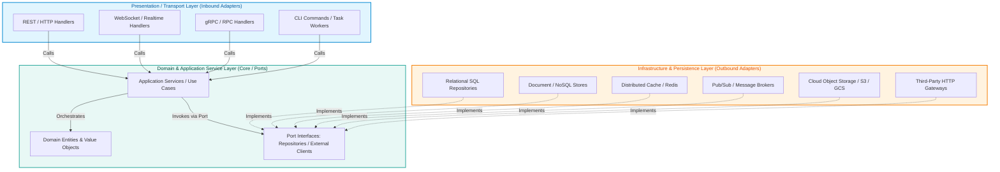
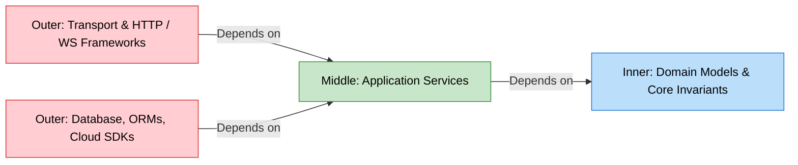
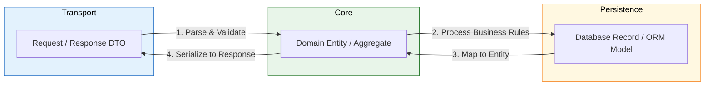
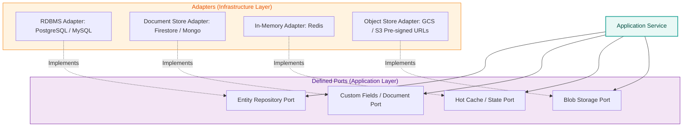
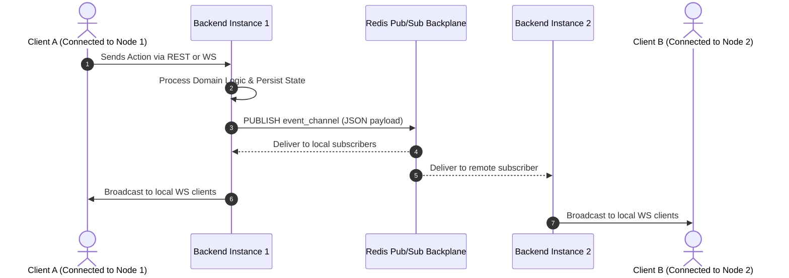
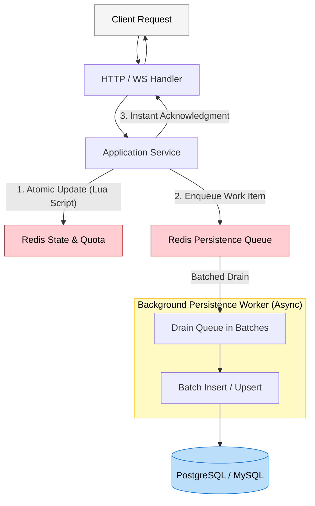
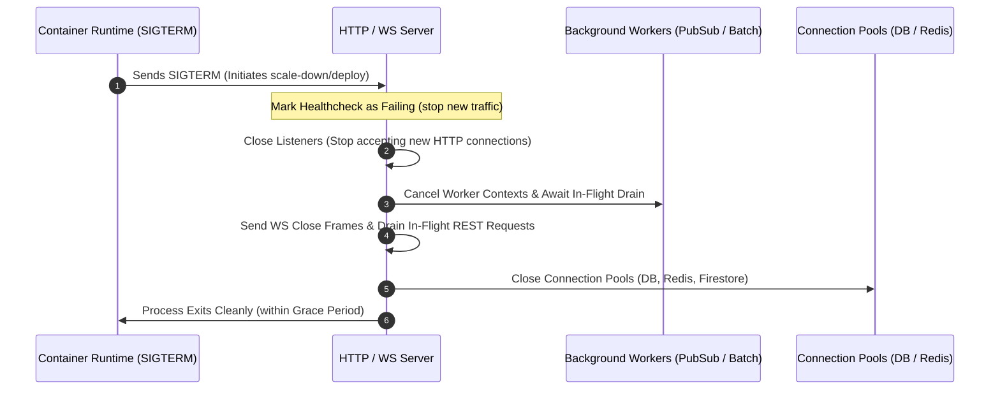

# Backend Architecture Blueprint: System Design & Clean Boundaries

## 1. Architectural Philosophy & Overview

This document specifies the mandatory architectural blueprints for all backend services across the organization. The core engineering goals are:
- **Maintainability & Isolation**: Business domain logic remains isolated from external transport protocols, UI frameworks, third-party SDKs, and database drivers.
- **Portability & Testability**: Components can be unit-tested in isolation using lightweight in-memory fakes/mocks without requiring live databases, message queues, or network sockets.
- **Stateless Horizontal Scaling**: Application servers remain strictly stateless, allowing dynamic auto-scaling across container instances while delegating state to managed persistence backplanes.
- **Predictable Evolution**: Modifying an API transport (e.g., REST to gRPC or WebSockets), swapping an ORM, or replacing a storage engine requires zero modifications to core business rules.

We adopt the **Clean Architecture / Hexagonal Architecture (Ports and Adapters) / Modular Monolith** pattern.

---

## 2. Layered Architecture & Boundary Definitions

Every backend service is partitioned into three strictly segregated concentric layers:



### Layer Responsibilities Matrix

| Layer | Primary Role | Allowed Dependencies | Prohibited Concepts |
| :--- | :--- | :--- | :--- |
| **Presentation (Transport)** | Ingests requests, validates transport-level constraints, enforces route authentication/authorization, parses schemas, serializes standardized responses. | Application Service Interfaces, Request/Response DTOs, Transport Context. | Direct database access, raw SQL/ORM models, core business calculations, holding transactions. |
| **Domain & Application Services** | Implements pure business logic, invariants, workflow orchestration, and defines Port interfaces (Dependency Inversion). | Domain Entities, Port Interfaces, Internal Service DTOs, Pure Domain Types. | HTTP frameworks (`chi`, `gin`, `express`, `fastapi`), database drivers (`gorm`, `prisma`, `sqlx`), raw SQL, storage SDKs. |
| **Infrastructure (Persistence & External)** | Implements Port interfaces, executes database queries, manages ORM mapping, network connections, caching, message publishing, and external SDKs. | Port Interfaces, Database ORMs/Drivers, Cloud SDKs, Third-party APIs. | Bypassing business rules, altering domain entities without service supervision, returning ORM models directly to presentation. |

---

## 3. The Inward Dependency Rule

> **The Golden Rule**: Source code dependencies must always point inward toward high-level domain policies. Inner layers know nothing of outer layers.



### Enforcement Rules

1. **Dependency Inversion Principle (DIP)**:
   - High-level modules (Services) must never import low-level modules (Repositories/Adapters). Both depend on abstractions (Port Interfaces).
   - Abstractions are **owned by the consumer (Application Service)**, not by the implementer (Infrastructure).
2. **Framework Decoupling**:
   - The Domain and Application Service layers must compile and test cleanly without any HTTP framework, routing library, or database driver in their dependency tree.
3. **No Direct ORM Exposure**:
   - Domain functions must never accept or return ORM-managed entities (e.g., `gorm.Model`, ActiveRecord, Prisma generated delegates, or Hibernate proxy objects).

---

## 4. Service & Domain Boundaries: The 3-Tier Data Model

To prevent persistence details or transport details from polluting the core business domain, services maintain strict separation between three distinct data representations:



### 1. Data Transfer Objects (DTOs)
- **Scope**: Presentation layer.
- **Purpose**: Defines the serializable public contract (JSON, Protobuf, Query parameters).
- **Properties**: Tagged with serialization annotations (`json:"..."`, schema tags), validated against schema constraints (regex, string lengths, ranges).
- **Constraint**: Must never contain database annotations or business rule methods.

### 2. Domain Entities & Value Objects
- **Scope**: Domain layer.
- **Purpose**: Represents real-world concepts and guarantees domain invariants (e.g., `OrderStatus`, `UserBalance`).
- **Properties**: Encapsulates state and enforces validation rules (e.g., `account.Debit(amount)` validates that balance $\ge$ amount).
- **Constraint**: Plain objects/structs without transport or persistence dependencies.

### 3. Database Records (ORM Models / Persistence Schemas)
- **Scope**: Infrastructure layer.
- **Purpose**: Reflects table schemas, foreign keys, indices, and database-specific data types (e.g., `VARCHAR(255)`, `TIMESTAMPTZ`, JSONB columns).
- **Properties**: Decorated with ORM tags (`gorm:"column:..."`, table decorators, migration metadata).
- **Constraint**: Must never leak outside the Infrastructure layer or repository boundaries.

### End-to-End Data Flow & Envelope Wrapping

```
[HTTP Request Payload] 
      ↓ (Handler / Controller: enforces MaxBytesReader, validates DTO schema)
[Request DTO] 
      ↓ (Mapper: DTO -> Domain Entity)
[Domain Entity]
      ↓ (Repository: Domain Entity -> DB Record)
[Database Record / SQL Query Execution]
      ↓ (Repository: DB Record -> Domain Entity)
[Domain Entity]
      ↓ (Mapper: Domain Entity -> Response DTO)
[Response DTO] 
      ↓ (Handler: wraps into standard response envelope)
[Standard Response Envelope: { "status": { "code": 1000, "header": "Success", "description": "Success" }, "result": {}, "total": 42, "search_params": {} }]
```

> [!IMPORTANT]
> **Authoritative Response Envelope**: See [backend-standards.md](backend-standards.md#3-universal-response--error-envelope-specification) for the authoritative schema specification and complete status code catalog. The outer envelope strictly exposes top-level keys `status`, `result`, `total`, and `search_params`. Nested within `status` are `code`, `header`, and `description`. Code generation agents must never confuse outer envelope properties with nested `status` properties or return un-enveloped raw DTOs.

---

## 5. Polyglot Persistence Layer Architecture

Production backend services often leverage specialized storage technologies according to access patterns. Port interfaces isolate the application service from storage heterogeneity:



1. **Relational Core (RDBMS / SQL)**:
   - Manages core entities, transactional relationships, foreign keys, and strong ACID guarantees.
2. **Document / Flexible Schema Store (NoSQL)**:
   - Stores user-defined custom attributes, dynamic JSON schemas, or audit logs that vary per entity type without requiring continuous schema migrations.
3. **In-Memory Cache & Key-Value (Redis)**:
   - Fast cache lookups, session token hashes, sliding-window rate limit counters, and real-time distributed state.
4. **Cloud Object Storage (S3 / GCS)**:
   - Binary assets (images, documents, reports) are stored in object storage.
   - **Pre-signed URL Pattern**: Handlers never stream heavy file uploads/downloads through the application server; they generate pre-signed upload/download URLs via the storage port, delegating I/O bandwidth directly to the storage bucket.

---

## 6. Real-Time & Multi-Instance Synchronization Architecture

In containerized, auto-scaling environments, backend services run across multiple stateless instances. Real-time protocols (WebSockets, Server-Sent Events) must broadcast events reliably across all nodes:



### Architectural Principles for Real-Time Systems:
1. **Local Hub, Distributed Backplane**:
   - Each service instance manages a local in-memory Connection Hub (`Hub`) tracking active WebSocket/SSE client connections.
   - A shared message broker (Redis Pub/Sub) acts as the cross-instance backplane. When state changes on any instance, an event is published to Redis. All instances subscribed to the channel receive the message and forward it to their locally connected clients.
2. **Connection Scoping & Channels**:
   - WebSocket connections are partitioned by scope (e.g., Session ID, Group ID, or User ID).
   - Redis Pub/Sub channels mirror these scopes (e.g., `events:session:{id}`), preventing noisy broadcasts to unrelated instances.
3. **State Recovery & Hydration**:
   - WebSockets are ephemeral; connections drop during autoscaling, network transitions, or deployments.
   - Clients must query the REST API for initial state upon reconnection, using WebSockets solely for delta updates.

---

## 7. High-Throughput Write Buffering & Asynchronous Workers

For operations with severe write contention (e.g., high-frequency voting, reaction bursts, metrics counters), executing direct database writes for every incoming request causes database lock saturation and connection exhaustion.

### Write-Behind (Write-Back) Caching Architecture:



1. **Atomic In-Memory Verification**: Redis validates quotas and mutates state in an atomic operation (e.g., using Lua scripts or transactions).
2. **Asynchronous Enqueueing**: The mutation is appended to a persistent FIFO queue (e.g., Redis List or Stream).
3. **Batch Persistence Worker**: A dedicated background goroutine/worker drains queue items in batches (e.g., every 500ms or 100 items) and performs batched database inserts/updates.
4. **Hydration & Cache Stampede Defense**: When cache misses occur, use a distributed hydration lock with short TTL (e.g., 10 seconds) to ensure only one worker queries the primary database and repopulates cache.

---

## 8. Transaction Management & Unit of Work

Multi-write operations that alter state across multiple tables or domain aggregates must guarantee ACID compliance.

### 8.1 Transaction Ownership Rules
1. **Service Layer Initiates**: The application service decides the transactional boundary based on business workflows.
2. **Infrastructure Executes**: The application service must never directly invoke `BEGIN` or `COMMIT` or hold database connection handles.
3. **Atomic Unit-of-Work (UoW)**: Use a Unit of Work or transactional runner abstraction that exposes repository ports bound to the active transaction.

### 8.2 Transactional Runner Contract

```go
type TransactionManager interface {
    // WithinTransaction executes fn inside an atomic transaction.
    // If fn returns an error or panics, the transaction rolls back; otherwise it commits.
    WithinTransaction(ctx context.Context, fn func(ctx context.Context) error) error
}
```

### 8.3 Transaction Guidelines
- **Zero Remote I/O in Transactions**: Never perform slow external network calls (HTTP requests to third-party APIs, remote file uploads) inside an open database transaction lock. Reserve transactions strictly for local database state transitions.
- **Rollback by Default**: Any unhandled panic or returned error must guarantee an immediate rollback.
- **Transactional Outbox**: When an operation updates a database record and produces an asynchronous event/message, write the event into an `outbox` table within the same transaction. A background worker subsequently dispatches outbox events.

---

## 9. Server Lifecycle, Concurrency & Graceful Shutdown

Stateless services running in managed container environments (such as Cloud Run, Kubernetes, or ECS) undergo frequent autoscaling and deployment terminations.



1. **Graceful Shutdown Duration**:
   - The shutdown grace period must stay safely below the platform's hard termination deadline (e.g., Cloud Run sends `SIGKILL` after 10s; app grace period should be 7–8s).
2. **Connection Draining**:
   - Stop accepting new incoming requests immediately upon `SIGTERM`.
   - Allow in-flight REST requests to complete.
   - Send WebSocket close frames (`CloseGoingAway` / `1001`) and close active socket loops gracefully.
3. **Worker Lifecycle Management**:
   - Background workers (Redis subscribers, persistence queues) must listen to root application context cancellation (`ctx.Done()`), finish in-flight batches, and flush pending buffers before process exit.

---

## 10. Architectural Anti-Patterns Catalog

| Anti-Pattern | Description | Remediation |
| :--- | :--- | :--- |
| **Leaky Abstraction** | Transport objects (e.g., `http.Request`, framework context) passed into Service or Repository methods. | Unpack values into strongly typed DTOs in the Presentation handler before calling the Service. |
| **Global Timeout on Persistent Connections** | Applying a standard 25s HTTP request timeout middleware globally across WebSocket upgrade routes. | Scope HTTP timeout middleware exclusively to REST routes; manage WebSocket lifecycles via ping/pong heartbeats. |
| **Direct ORM Leakage** | Exposing GORM/Prisma/Hibernate records directly in HTTP response payloads. | Always map through Response DTOs. Prevents leaking internal IDs, password hashes, or internal database schemas. |
| **Streaming Large Files Through App Compute** | Buffering multi-megabyte user file uploads in application memory before saving to storage. | Use the Pre-signed URL pattern to allow client direct uploads to Cloud Object Storage. |
| **Single-Node In-Memory Real-Time Hubs** | Maintaining WebSocket client maps in local memory without a Pub/Sub backplane. | Integrate a distributed broker (Redis Pub/Sub) so multiple scaled instances synchronize broadcasts. |
| **Direct Database Writes Under Spike Loads** | Hitting primary RDBMS with concurrent individual write queries during high-concurrency voting or reactions. | Implement Write-Behind buffering via in-memory queues and batched persistence workers. |
