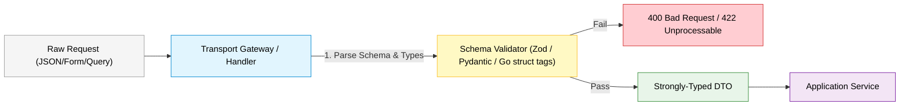
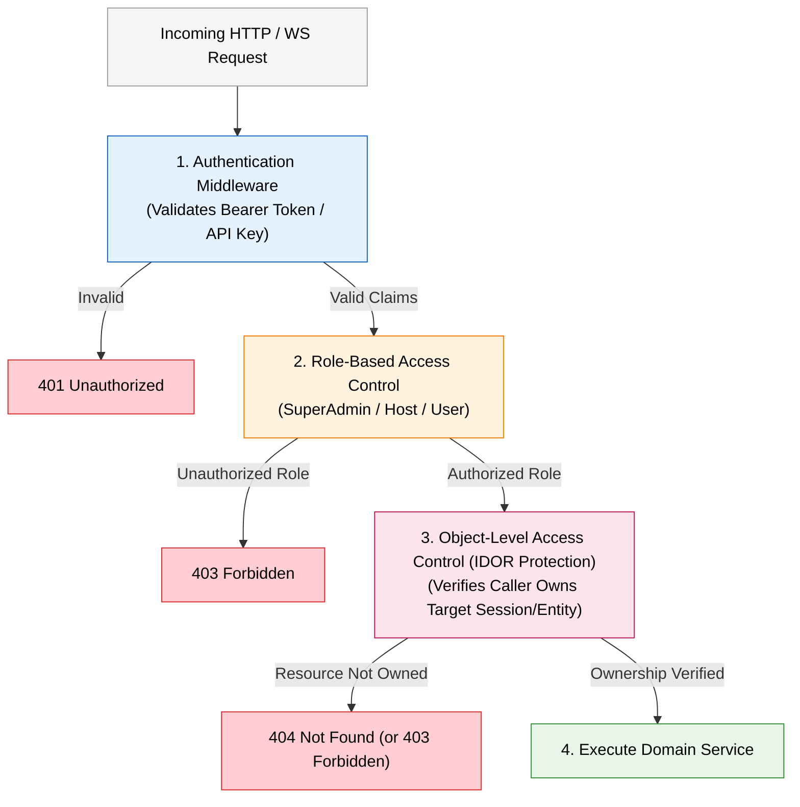

# Backend Engineering & Quality Standards: APIs, Security & Quality

## 1. API Design & HTTP/WebSocket Transport Standards

### 1.1 Route Segregation & URI Conventions
- **Naming Scheme**: URLs must use lowercase characters with words separated by hyphens (`kebab-case`).
- **Resource Plurality**: Use plural nouns for collections (e.g., `/api/v1/users`, `/api/v1/sessions`).
- **Transport Route Partitioning**:
  - `/api/v1/...` for synchronous request-response REST APIs.
  - `/ws/...` for persistent WebSocket connection upgrade endpoints.
- **Nesting Depth**: Limit nested sub-resources to a maximum depth of two levels.
  - Good: `/api/v1/sessions/{session_id}/groups`
  - Bad: `/api/v1/workspaces/{ws_id}/sessions/{sess_id}/groups/{grp_id}/ideas` (flatten deep routes by filtering: `/api/v1/ideas?group_id=...`).
- **Semantic Versioning**: All public endpoints must include a major version prefix in the path (`/api/v1/...`). Breaking contract changes mandate a version bump.

### 1.2 HTTP Methods & Semantics
- `GET`: Safe and idempotent. Used exclusively to retrieve resources. Must never alter server state.
- `POST`: Non-idempotent. Creates a subordinate resource or executes a non-CRUD command (e.g., `/api/v1/sessions/{id}/join`).
- `PUT`: Idempotent. Replaces the target resource or collection state in its entirety.
- `PATCH`: Applies partial updates to a resource.
- `DELETE`: Idempotent. Removes the target resource.

### 1.3 HTTP Status Codes Matrix

| Code | Status | Exact Usage Scenario |
| :--- | :--- | :--- |
| **200** | OK | Successful `GET`, `PATCH`, or `PUT` returning a payload. |
| **201** | Created | Successful `POST` creating a resource. Includes `Location` header or created object in body. |
| **204** | No Content | Successful operation returning an empty response body (commonly `DELETE`). |
| **400** | Bad Request | Syntactically invalid payload, missing required parameters, or failed transport validation. |
| **401** | Unauthorized | Missing, expired, or cryptographically invalid authentication token or API key. |
| **402** | Payment Required | Billing or subscription quota exhausted. |
| **403** | Forbidden | Valid authentication token provided, but caller lacks authorization for this resource (RBAC/IDOR). |
| **404** | Not Found | Requested URI, resource identifier, or route does not exist. |
| **409** | Conflict | Unique constraint violation, state transition conflict, or optimistic lock failure. |
| **422** | Unprocessable Entity | Well-formed payload failing semantic or business validation rules. |
| **429** | Too Many Requests | Rate limit or concurrency quota exceeded. Must include `Retry-After` header. |
| **500** | Internal Server Error | Unhandled server error or unexpected infrastructure failure. Must never leak internal diagnostics. |
| **503** | Service Unavailable | Downstream dependency or database temporarily unreachable during maintenance/failover. |

### 1.4 Transport Timeout Scoping Rule
> [!CRITICAL]
> **Strict Timeout Scoping**: Standard HTTP request timeout middleware (e.g., `Timeout(25 * time.Second)`) must be scoped strictly to `/api` REST routes. It must **NEVER** wrap `/ws` WebSocket routes, otherwise persistent connections will be forcibly severed mid-session.

### 1.5 WebSocket Handshake & Connection Standards
1. **Authentication during Handshake**:
   - Because standard browser JavaScript (`new WebSocket(url)`) cannot send custom HTTP headers (such as `Authorization: Bearer` or `X-API-Key`), WebSocket upgrade endpoints must accept credentials via URL query parameters (e.g., `?api_key=...` or a short-lived handshake ticket).
   - Validate credentials and authorization *before* executing the HTTP protocol upgrade. If unauthorized, reject with HTTP 401/403 immediately.
2. **Heartbeats & Liveness**:
   - Server must send periodic WebSocket Ping frames (every 25–30s); disconnect client if Pong is not received within the timeout deadline.
3. **Client Reconnection Strategy**:
   - Frontend clients must anticipate disconnects and implement exponential backoff with jitter.
   - Initial state must be re-fetched via REST upon reconnection, using WebSocket solely for live delta broadcasts.
4. **Container Concurrency & Quotas**:
   - In container runtimes (e.g., Cloud Run, ECS), each open WebSocket connection occupies 1 concurrency slot for its full lifetime. Service configuration must elevate concurrency limits and configure container request timeouts (e.g., 3600s instead of default 300s) to avoid starving REST traffic.

### 1.6 Request Body Limits & DoS Protection
All handlers ingesting HTTP request bodies must enforce a maximum payload size before decoding:
```go
r.Body = http.MaxBytesReader(w, r.Body, 1048576) // 1MB limit for standard JSON payloads
```

---

## 2. Input Validation at Gateway & Presentation Boundaries

Validation must occur at the presentation layer **before** data enters application services or business logic.



### 2.1 Validation Rules
1. **Schema-First Validation**: Use declarative schema libraries (e.g., Zod in TypeScript, Pydantic in Python, Struct Tags + Validator in Go) for strict shape and type verification.
2. **String Hygiene**:
   - Strip leading and trailing whitespace (`TrimSpace`).
   - Enforce bounded length constraints (e.g., `min: 1, max: 255`). Never accept unbounded strings into databases.
3. **Identifier Format**: Enforce exact format checks (UUIDv4/UUIDv7, ULID, ISO-8601 timestamps, valid email/E.164 phone formats).
4. **Pagination Hard Limits**:
   - `page`: default `1`, minimum `1`.
   - `limit` / `page_size`: default `20`, maximum `100` strictly enforced. Never permit client to request unbounded sets (`limit=ALL` or `limit=10000`).
5. **Sort & Filter Allowlisting**:
   - Sort columns and sort orders (`asc`, `desc`) must be checked against an explicit immutable allowlist. Never interpolate client sort strings directly into queries.

---

---

## 3. Universal Response & Error Envelope Specification

Every HTTP API endpoint across all backend services must strictly adhere to the organizational JSON envelope contract established in `internal/utils/envelope.go`.

### 3.1 Envelope Schema & Structure

All responses wrap their payload inside a standard four-field envelope:
```json
{
  "status": {
    "code": 1000,
    "header": "Success",
    "description": "Success"
  },
  "result": {},
  "total": 42,
  "search_params": {}
}
```

#### Envelope Field Specification

| Field | Type | Serialization Rule | Description |
| :--- | :--- | :--- | :--- |
| `status` | `StatusInfo` | Always present | Encapsulates the machine-readable application code, title header, and human-readable description. |
| `status.code` | `integer` | Always present | Organizational application status code (e.g., `1000`, `1801`, `1802`, etc.). |
| `status.header` | `string` | Always present | High-level status category (e.g., `"Success"`, `"Invalid request"`, `"Not found"`). |
| `status.description`| `string` | Always present | Context-specific outcome or error explanation. |
| `result` | `any` | `omitempty` | Data payload. Populated on successful reads/mutations; omitted on errors. |
| `total` | `*int` | `omitempty` | Total record count for paginated collection queries; omitted when not applicable. |
| `search_params` | `map[string]any` | `omitempty` | Echoes the filter/query parameters that produced the result (e.g., date ranges, pagination); omitted when empty. |

---

### 3.2 Standard Organizational Status Codes Catalog

The application status code communicates domain outcome semantics alongside the HTTP transport status code:

| Application Code | Header | Description Format | Paired HTTP Status | Usage Scenario | Helper Function |
| :---: | :--- | :--- | :---: | :--- | :--- |
| **`1000`** | `Success` | `Success` | **200 OK / 201 Created** | Successful request processing. | `SuccessResponse`, `SuccessWithTotal`, `SuccessWithSearchParams` |
| **`1799`** | `Unable to proceed` | `<entity> already exists` or custom conflict message | **409 Conflict** | Unique constraint violation, duplicate key, or state conflict. | `DuplicateErrorResponse(entity)`, `DuplicateErrorResponseMsg(msg)` |
| **`1801`** | `Invalid request` | `<validation message>` | **400 Bad Request** | Request body/parameter failed syntactic or schema validation. | `ValidationErrorResponse(msg)` |
| **`1802`** | `Not found` | `<entity> not found` | **404 Not Found** | Target resource ID does not exist or caller cannot view it. | `NotFoundErrorResponse(entity)` |
| **`1803`** | `Unauthorized` | `Invalid username or password` | **401 Unauthorized** | Missing, malformed, or invalid authentication token/API key. | `UnauthorizedErrorResponse()` |
| **`1899`** | `Unable to proceed` | `We cannot process your request at this moment. Please try again later.` | **400 Bad Request** | Generic malformed client request catch-all (e.g. unparseable JSON). | `GenericErrorResponse()` |
| **`1900`** | `Server error` | `An unexpected server error occurred. Please try again later.` | **500 Internal Server Error** | Unexpected operational failure, downstream service, or DB timeout. | `ServerErrorResponse()` |
| **`1999`** | `Internal Server Error` | `We cannot process your request at this moment.` | **500 Internal Server Error** | Unhandled server exception or panic recovery. | `InternalErrorResponse()` |

---

### 3.3 Concrete Response Envelope Examples

#### 1. Single Entity Success (`SuccessResponse`)
HTTP `200 OK` or `201 Created`:
```json
{
  "status": {
    "code": 1000,
    "header": "Success",
    "description": "Success"
  },
  "result": {
    "user_id": "9b1deb4d-3b7d-4bad-9bdd-2b0d7b3dcb6d",
    "group_id": "4a2c0b6e-1d5f-4a3b-8c2e-9d8e7f6a5b4c",
    "user_name": "alex_smith",
    "status": "ACTIVE",
    "created_at": "2026-03-31T09:30:00Z"
  }
}
```

#### 2. Paginated Collection Success (`SuccessWithTotal`)
HTTP `200 OK`:
```json
{
  "status": {
    "code": 1000,
    "header": "Success",
    "description": "Success"
  },
  "result": [
    {
      "user_id": "9b1deb4d-3b7d-4bad-9bdd-2b0d7b3dcb6d",
      "user_name": "alex_smith"
    },
    {
      "user_id": "8c2e9d8e-7f6a-5b4c-9b1d-eb4d3b7d4bad",
      "user_name": "jordan_taylor"
    }
  ],
  "total": 42
}
```

#### 3. Paginated Search with Filter Echo (`SuccessWithSearchParams`)
HTTP `200 OK`:
```json
{
  "status": {
    "code": 1000,
    "header": "Success",
    "description": "Success"
  },
  "result": [
    { "session_id": "a1b2c3d4-e5f6-7890-abcd-ef1234567890", "status": "COMPLETED" }
  ],
  "total": 1,
  "search_params": {
    "start_time": "2026-09-14T00:00:00Z",
    "end_time": "2026-09-18T23:59:59Z",
    "page": 1,
    "limit": 10
  }
}
```

#### 4. Validation Error (`ValidationErrorResponse`)
HTTP `400 Bad Request`:
```json
{
  "status": {
    "code": 1801,
    "header": "Invalid request",
    "description": "user_name is required and must be 255 characters or fewer"
  }
}
```

#### 5. Resource Not Found Error (`NotFoundErrorResponse`)
HTTP `404 Not Found`:
```json
{
  "status": {
    "code": 1802,
    "header": "Not found",
    "description": "session not found"
  }
}
```

#### 6. Duplicate / State Conflict Error (`DuplicateErrorResponseMsg`)
HTTP `409 Conflict`:
```json
{
  "status": {
    "code": 1799,
    "header": "Unable to proceed",
    "description": "user_name already exists in this group"
  }
}
```

#### 7. Unauthorized Error (`UnauthorizedErrorResponse`)
HTTP `401 Unauthorized`:
```json
{
  "status": {
    "code": 1803,
    "header": "Unauthorized",
    "description": "Invalid username or password"
  }
}
```

#### 8. Server Error (`ServerErrorResponse`)
HTTP `500 Internal Server Error`:
```json
{
  "status": {
    "code": 1900,
    "header": "Server error",
    "description": "An unexpected server error occurred. Please try again later."
  }
}
```

### 3.4 Security & Leakage Prevention Rule
Internal implementation details (e.g., SQL queries, GORM/driver error text, stack traces, database table schemas) must **NEVER** appear in `status.description` or any part of the envelope sent to clients. The handler must log the detailed error internally with request correlation IDs and return the appropriate sanitized envelope helper.

---

## 4. Persistence, Storage & Database Guidelines

### 4.1 SQL & Query Safety
1. **Zero String Concatenation**: Parameterized queries or prepared statements are mandatory. Never concatenate user-supplied input into SQL strings.
2. **Selective Column Retrieval**: Avoid `SELECT *`. Explicitly select required columns to conserve memory, reduce network overhead, and leverage covering indexes.
3. **Eliminating N+1 Queries**:
   - Forbidden: Iterating over $N$ entities and querying child records inside the loop.
   - Required: Use SQL `JOIN`, batch fetching (`WHERE parent_id IN (...)`), or dataloader patterns.

### 4.2 Indexing Strategy
- **Foreign Keys**: Every foreign key column must have an explicit B-tree index.
- **Composite Indexes**: Follow the **Equality, Sort, Range (ESR)** rule when defining composite index columns:
  1. Equality columns first (`status = 'ACTIVE'`).
  2. Sorting columns second (`ORDER BY created_at DESC`).
  3. Range columns last (`amount > 100`).
- **Covering Indexes**: Where query latency is critical, index include columns to allow index-only scans without table heap lookups.

### 4.3 Safe Zero-Downtime Database Migrations
Migrations must follow the **Expand and Contract (Parallel Run)** pattern:
1. **Phase 1 (Expand)**: Add the new column/table as nullable or with safe defaults. Application writes to both old and new columns.
2. **Phase 2 (Backfill)**: Run asynchronous background jobs to backfill existing records.
3. **Phase 3 (Switch)**: Application switches to reading and writing exclusively from the new schema.
4. **Phase 4 (Contract)**: Drop old columns or tables in a subsequent deployment.

> **Forbidden Operations**: Never execute long-running exclusive locks (`ALTER TABLE ... ADD COLUMN ... DEFAULT <complex>` on large tables, unindexed column locks, or table renames) in a single deployment.

### 4.4 Direct-to-Storage Upload Standard (Pre-Signed URLs)
Services handling binary assets (images, PDFs, media) must never stream file uploads through backend compute servers.
- **Pattern**:
  1. Client calls `POST /api/v1/storage/signed-url` specifying file name, MIME type, and size.
  2. Backend validates authentication, permissions, and file size quotas.
  3. Backend generates a short-lived (e.g., 15-minute) signed upload URL (S3/GCS) and returns it in the response DTO.
  4. Client uploads binary payload directly to Object Storage using HTTP `PUT`.
  5. Client notifies backend with metadata after upload completes.

### 4.5 High-Throughput Write-Behind Buffering
For high-write endpoints (voting, reactions, telemetry):
- Perform atomic updates and quota checks in Redis (using Lua scripts).
- Append write operations to a Redis queue.
- Use a dedicated background worker to batch-persist records into PostgreSQL/MySQL.
- Use distributed hydration locks with short TTL (e.g., 10 seconds) to guard against cache stampedes.

---

## 5. Security & Authentication/Authorization Baseline

### 5.1 Authentication Standard
- **Transport**: HTTPS/TLS 1.3 is non-negotiable for all external and service-to-service communication.
- **Headers & Keys**:
  - Bearer token: `Authorization: Bearer <token>`
  - API Key: `X-API-Key: <key>` for HTTP; `?api_key=<key>` on WebSocket upgrade handshake.
- **Timing Attack Defense**:
  - Always validate static tokens, superadmin keys, and HMAC signatures using **constant-time comparisons**:
    ```go
    subtle.ConstantTimeCompare([]byte(clientKey), []byte(configuredKey)) == 1
    ```
- **Token & Identity Caching**:
  - Hash incoming API keys (`sha256(key)`) and cache validated identity claims in Redis with an explicit TTL (e.g., 5–15 minutes). This prevents database lookups on every incoming request.

### 5.2 Authorization Architecture: Defense in Depth



1. **Authentication vs Authorization**: Authenticating identity does NOT permit action on a specific record.
2. **Object-Level Authorization (BOLA/IDOR Prevention)**:
   - For every resource accessed via path parameter (e.g., `/sessions/{session_id}`, `/ideas/{idea_id}`), verify that the caller owns or belongs to that specific session/group.
   - Return `404 Not Found` (or `403 Forbidden`) when access is denied to avoid confirming the existence of records owned by other callers.
3. **Untrusted Identity in Payloads**:
   - Never trust client-supplied `user_id`, `role`, or `tenant_id` inside request bodies. Identity must always be extracted from authenticated claims set in the request context.

### 5.3 Cross-Origin Resource Sharing (CORS)
- Explicit origin allowlists only. Never use `Access-Control-Allow-Origin: *` in combination with `Access-Control-Allow-Credentials: true`.
- Allowed methods: `GET, POST, PUT, PATCH, DELETE, OPTIONS`.
- Allowed headers: `Accept, Authorization, Content-Type, X-API-Key, X-Request-ID`.

---

## 6. Observability, Structured Logging & Testing Standards

### 6.1 Structured JSON Logging
Every log entry must be serialized as single-line structured JSON with consistent metadata fields:

```json
{
  "timestamp": "2026-03-31T09:30:15.123Z",
  "level": "INFO",
  "service": "collaboration-service",
  "trace_id": "4bf92f3577b34da6a3ce929d0e0e4736",
  "span_id": "00f067aa0ba902b7",
  "request_id": "req-9876543210-abcdef",
  "method": "POST",
  "path": "/api/v1/ideas",
  "status": 201,
  "duration_ms": 34.20,
  "message": "Idea created successfully",
  "session_id": "sess_12345"
}
```

#### Log Hygiene & Zero PII Policy
The following must **NEVER** appear in logs:
- Raw API keys, passwords, or hashes.
- Bearer tokens, session cookies, or refresh tokens.
- PII: unmasked credit cards, personal identifiers, or phone numbers.

### 6.2 Testing Standards
1. **Unit Testing**:
   - Co-located with implementation files (e.g., `service_test.go`, `handler_test.go`).
   - Use table-driven test patterns covering happy paths, validation edge cases, and unauthorized branches.
   - Test against domain interfaces using in-memory fakes. No network or database I/O in unit tests.
2. **Integration Testing**:
   - Run against transient, isolated test databases.
   - Execute actual database migrations prior to running test suites.
   - Clean up state between test runs using transaction rollbacks or database truncation.
3. **Concurrency & Race Detection**:
   - Multi-threaded code, background persistence workers, and WebSocket hubs must pass race condition checkers:
     ```sh
     go test ./... -race -count=1
     ```

---

## 7. Engineering Compliance Checklist

Before opening a pull request or deploying an endpoint, verify:

- [ ] **Route Segregation**: REST routes mounted under `/api/v1/...`; WebSockets strictly under `/ws/...`.
- [ ] **Timeout Scoping**: Request timeout middleware is scoped to `/api` and does NOT wrap `/ws`.
- [ ] **WebSocket Handshake Auth**: Handshake validates query parameter token before protocol upgrade; handles ping/pong.
- [ ] **Request Size Bound**: Request body size restricted via maximum byte reader (`http.MaxBytesReader`).
- [ ] **Input Validation**: Schema validation executed before payload reaches domain services.
- [ ] **Standard Envelopes**: Response envelope strictly preserves `internal/utils/envelope.go` schema (`status: { code, header, description }`, `result`, `total`, `search_params`).
- [ ] **Timing Attack Protection**: Secret comparisons use constant-time comparisons (`subtle.ConstantTimeCompare`).
- [ ] **Token Caching**: Auth tokens/identities cached in Redis to prevent DB lookups on every request.
- [ ] **Object-Level Authorization (IDOR)**: Caller ownership verified for every path/query resource ID.
- [ ] **Identity Derivation**: User/tenant identity extracted from authenticated context, never trusted from client body.
- [ ] **File Storage**: Large files use pre-signed upload URLs; never streamed through application compute.
- [ ] **High-Throughput Operations**: Write-heavy operations leverage in-memory write buffering and batch workers.
- [ ] **Database Queries**: Parameterized queries only; no unindexed foreign keys; no N+1 query loops.
- [ ] **Migration Safety**: Schema changes use expand-and-contract migrations without long exclusive locks.
- [ ] **Context & Timeouts**: Context cancellation propagated to all database queries and external calls.
- [ ] **Logging & Observability**: Structured JSON logging; zero secrets, tokens, or PII logged.
- [ ] **Testing Coverage**: Unit tests cover happy path, boundaries, and unauthorized branches. Race detector runs cleanly (`-race`).
