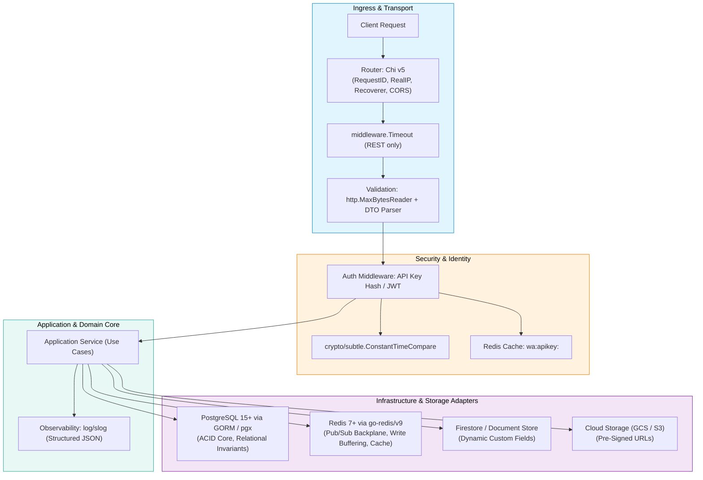

# Backend Technology Stack & Tooling Specification

## 1. Architectural Philosophy & Governance Model

Without explicit tech stack governance, backend systems and AI agents suffer from stack fragmentation: mixing conflicting HTTP routers, incompatible ORMs, inconsistent database drivers, ad-hoc caching solutions, and fragmented testing tools across services.

To balance strict organizational quality with engineering pragmatism, all backend technologies are classified into a **Three-Tier Governance Model**:

```
+-----------------------------------------------------------------------------------------+
|                                TECH STACK GOVERNANCE TIERS                              |
+--------------------------+------------------------------+-------------------------------+
| Tier 1: The Golden Path  | Tier 2: Approved Exceptions  | Tier 3: Strictly Prohibited   |
| Default standard for 90%+ | Permitted only with written  | Banned in new projects;       |
| of new backend services. | architectural justification. | trigger instant PR rejection. |
+--------------------------+------------------------------+-------------------------------+
```

- **Tier 1 (The Golden Path)**: The battle-tested, blessed stack. Standard tooling, shared lint rules (`golangci-lint`), CI/CD pipelines, container base images, and AI agent prompts are optimized around this path.
- **Tier 2 (Approved Exceptions)**: Permitted when specific project constraints rule out Tier 1 (e.g., Python/FastAPI for AI/ML inference pipelines, TypeScript/Node.js for lightweight BFF gateways, or specialized protocol engines).
- **Tier 3 (Strictly Prohibited)**: Technologies that introduce maintenance hazards, concurrency deadlocks, high memory footprints, or architectural anti-patterns.

---

## 2. The Organizational Backend Tech Stack Matrix

| Domain | Tier 1: The Golden Path (Default) | Tier 2: Approved Exceptions | Tier 3: Strictly Prohibited |
| :--- | :--- | :--- | :--- |
| **Language & Runtime** | **Go 1.22+**<br>Strict `gofmt`, error wrapping `%w`, race detector (`-race`), context propagation. | **TypeScript 5.x / Node.js 20+** (BFF only);<br>**Python 3.11+ / FastAPI** (AI/ML inference only). | Plain untyped JavaScript, PHP, Ruby, Java 8, Go without `gofmt` / `govet`. |
| **HTTP Routing & Middleware** | **Chi v5** (`github.com/go-chi/chi/v5`)<br>Lightweight, 100% `net/http` compatible, idiomatic sub-routing and middleware chaining. | **Go 1.22+ `net/http` ServeMux** (simple utilities);<br>**Gin** (legacy maintenance). | Heavy opinionated monolithic frameworks (Beego, Iris, Martini, Express without TS). |
| **Real-Time & WebSockets** | **`github.com/gorilla/websocket`** or **`nhooyr.io/websocket`** with **Redis Pub/Sub** multi-instance sync backplane. | **Server-Sent Events (SSE)** via `net/http` (unidirectional);<br>**gRPC Streaming** (internal service-to-service). | Socket.io with in-memory adapter (breaks on auto-scaling), polling loops, unmanaged raw TCP sockets. |
| **Relational Database & ORM** | **PostgreSQL 15+** via **GORM** (`gorm.io/gorm`) or **pgx/v5** / **sqlx**.<br>Parameterized queries, explicit transaction blocks. | **MySQL 8.0+** / **MariaDB**;<br>**SQLite** (isolated testing / CLI utilities). | MongoDB for transactional relational core, raw unparameterized SQL concatenation, Hibernate/ActiveRecord implicit lazy-loading. |
| **In-Memory Cache & Key-Value** | **Redis 7+** via `github.com/redis/go-redis/v9`<br>Caching, token hashes, sliding-window rate limits, Lua atomic scripts, Pub/Sub backplane. | **Memcached** (pure key-value cache);<br>**In-memory cache** (`sync.Map` / `ristretto` with explicit TTL) for single-node micro-caches. | Unbounded global Go maps without mutexes (race condition hazard), storing mutable session state in local process memory. |
| **Document & Dynamic Schemas** | **Google Cloud Firestore** / **MongoDB**<br>Dynamic user-defined fields, custom attributes, unindexed document blobs. | **PostgreSQL JSONB** with GIN indexes (when maintaining single database engine). | Relational EAV (Entity-Attribute-Value) anti-pattern tables in SQL with multi-table join cascades. |
| **Cloud Object / Blob Storage** | **Google Cloud Storage (GCS) / AWS S3**<br>Via **Pre-Signed Upload & Download URLs** (`PUT`/`GET`). | **Cloudflare R2** / **MinIO** (local dev and S3-compatible). | Storing binary files in PostgreSQL `BYTEA`/BLOBs, streaming multi-megabyte uploads through application compute memory. |
| **Authentication & Secrets** | **Bearer JWT** (RFC 7519) + **API Key Hashing** (`sha256`) with Redis caching.<br>`crypto/subtle.ConstantTimeCompare`. | **OAuth2 / OIDC** with external IdP (Google Cloud IAP, Auth0, Keycloak). | Plaintext API keys in DB, storing secrets in git/code, `==` string equality for security tokens, session state in server memory. |
| **Input Validation & Parsing** | **`http.MaxBytesReader`** + **`go-playground/validator/v10`** or explicit DTO validation functions. | **Protocol Buffers** / `protoc-gen-validate` (for gRPC contracts). | Unchecked JSON deserialization directly into domain entities, unbounded request body decoding. |
| **Structured Logging** | Go standard **`log/slog`**<br>Single-line JSON handler with `trace_id`, `request_id`, `service`, `duration_ms`. | **`uber-go/zap`** or **`rs/zerolog`**. | `fmt.Println`, standard `log.Print` (unstructured text), logging passwords, auth tokens, or PII. |
| **Testing & Quality** | Standard **`testing`** package (table-driven tests), **`net/http/httptest`**, in-memory fakes, **`go test -race`**. | **`testcontainers-go`** (isolated database integration tests). | Testing against live production databases, skipping race detection, mock frameworks generating untyped reflection spaghetti. |
| **Container & Cloud Runtime** | **Multi-stage Dockerfile** (Alpine or Distroless non-root runtime), **Cloud Run / K8s / ECS**, **Makefile** targets. | **Linux Systemd** native binary on VM compute. | Bloated container images with build SDKs in production, running containers as root user. |

---

## 3. Tech Stack Integration Blueprint

The blessed Golden Path stack coordinates seamlessly across the Clean Architecture boundaries:



---

## 4. Key Architectural Rationale Behind the Choices

### 4.1 Why Go + Chi over Heavyweight Frameworks (e.g., Gin, Beego)?
1. **Standard Library Compatibility**: `chi` routers and middlewares implement pure `http.Handler` and `http.HandlerFunc`. Switching libraries or embedding sub-routers requires zero adapter boilerplate.
2. **Predictable Sub-Routing & Scoping**: `chi` allows clean prefix and group scoping (e.g., mounting timeout middleware strictly under `/api` while keeping `/ws` long-lived without timeouts).
3. **Zero Reflection Overhead**: Heavy frameworks use deep reflection and custom context objects (`gin.Context`) that leak transport details deep into code.

### 4.2 Why Redis Pub/Sub over WebSocket Sticky Sessions?
1. **True Autoscaling**: Sticky sessions prevent load balancers from distributing WebSocket traffic evenly across instances and fail during node rollouts or scale-down events.
2. **Decoupled Messaging**: With a Redis Pub/Sub backplane, instances remain 100% stateless. When instance A processes a state mutation, it publishes the event to Redis, which relays it to instances B and C to notify their local WebSocket subscribers.

### 4.3 Why Pre-Signed URLs over Streaming File Uploads Through Compute?
1. **Compute Resource Protection**: Buffering or proxying large files (10MB–500MB) consumes server memory, ties up HTTP handler goroutines, and degrades API latency.
2. **Direct Edge Upload**: Generating a 15-minute Pre-Signed PUT URL lets clients upload directly to Cloud Object Storage (GCS/S3), offloading file transfer I/O completely from application servers.

### 4.4 Why Standard `log/slog` over Third-Party Loggers?
1. **Zero External Dependency**: Since Go 1.21, `slog` is built directly into the Go standard library, eliminating third-party logger dependency lock-in.
2. **Native JSON Serialization**: Produces machine-readable single-line JSON logs that ingest seamlessly into Google Cloud Logging, Datadog, and ELK with zero transformation overhead.

### 4.5 Why Table-Driven Tests with In-Memory Fakes over Mock Frameworks?
1. **Refactoring Resilience**: Mock generation frameworks (e.g. `gomock`) test implementation details (e.g., "method X was called exactly 2 times with argument Y"). When internal queries are refactored, mock tests break even though business behavior is identical.
2. **Interface Fakes**: Fakes implement the domain Port interface using simple maps/slices in memory. Tests focus purely on inputs and resulting business outputs, allowing safe refactoring.

---

## 5. Technology Adoption Checklist

When initializing or reviewing a backend project:

- [ ] **Runtime**: Go 1.22+ configured with `-race` in test pipelines and `gofmt` enforcement.
- [ ] **Router**: Chi v5 with route segregation (`/api` for REST, `/ws` for WebSockets).
- [ ] **Payload Limits**: `http.MaxBytesReader` applied to every mutation handler.
- [ ] **Database**: PostgreSQL with parameterized queries via GORM/pgx; migrations managed cleanly.
- [ ] **Cache & Real-Time**: Redis used for hot state, token caching, and Pub/Sub backplane.
- [ ] **Security**: Constant-time comparison (`subtle.ConstantTimeCompare`) for secrets; tokens hashed with SHA-256 before caching.
- [ ] **Large Files**: Cloud Object Storage with Pre-Signed URLs; no direct compute streaming.
- [ ] **Logging**: `log/slog` structured JSON format with `request_id` / `trace_id`; zero PII/credentials logged.
- [ ] **Envelope**: All HTTP responses strictly preserve `internal/utils/envelope.go` schema (`status`, `result`, `total`, `search_params`).

