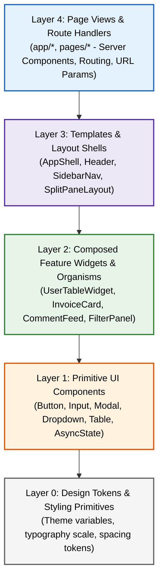
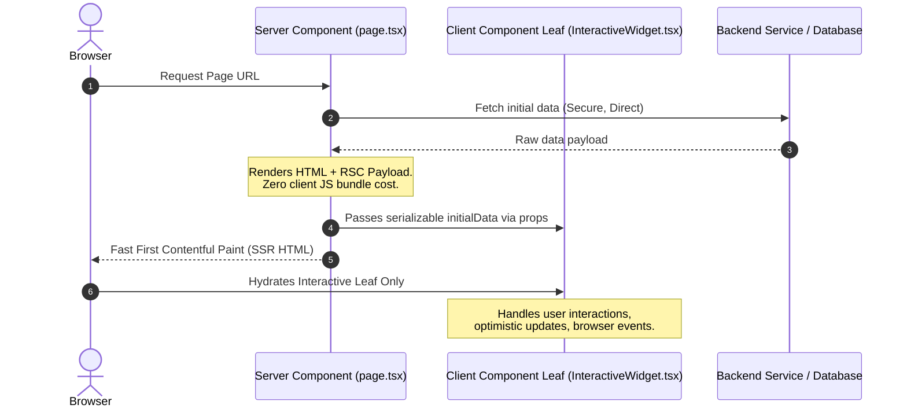
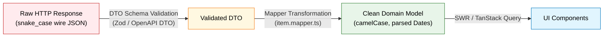

# Universal Frontend Architecture Specification

> **Audience & Authority**: This document establishes the non-negotiable architectural blueprint for all web frontend codebases across the organization. It applies universally to modern React and Next.js applications regardless of specific domain logic or brand styling.

---

## 1. Architectural Philosophy & Core Principles

Every web user interface engineered within the organization must adhere to four foundational architectural principles:

```
+----------------------------------------------------------------------------------+
|                              ARCHITECTURAL PILLARS                               |
+--------------------------+-----------------------------+-------------------------+
| Unidirectional Data Flow | Strict Separation of Bounds | Server-First Rendering  |
| State flows down via     | Distinct layers for UI,     | Compute & fetch close   |
| props/selectors; actions | domain logic, transport,    | to data; push client    |
| flow up via events.      | and state management.       | boundaries to leaves.   |
+--------------------------+-----------------------------+-------------------------+
```

1. **Unidirectional Data Flow**: State flows strictly down through explicit component props or granular store selectors; mutations flow strictly up through typed callbacks or dispatched actions.
2. **Strict Layer Boundary Isolation**: Primitive UI components must never know about backend endpoints, HTTP status codes, or global stores. Wire formats (DTOs) must never leak into view models.
3. **Server-First by Default**: In hybrid environments (Next.js / RSC), components are Server Components unless user interactivity, browser APIs, or client-side subscriptions explicitly necessitate `"use client"`.
4. **Predictable Determinism**: Given the same props and state, any presentation component must render identically across all viewports and environments without unintended side effects.

---

## 2. Directory & Component Structure

Frontend codebases must be structured into explicit architectural layers. Ad-hoc directory structures, circular dependencies, and tangled feature boundaries are strictly forbidden.

### 2.1 The 5-Layer Component Hierarchy



| Layer | Responsibility | Dependencies | Allowed Imports | Disallowed Imports |
| :--- | :--- | :--- | :--- | :--- |
| **Layer 0: Tokens** | CSS variables, color scales, typography, spacing tokens. | Pure CSS / Token objects. | None. | Frameworks, UI libraries. |
| **Layer 1: Primitives** | Generic atomic components (`Button`, `Input`, `Dialog`, `AsyncState`, `Tooltip`). | Layer 0, Base headless libs. | CSS tokens, headless UI (e.g. Radix, Lucide). | API clients, stores, app routes, feature logic. |
| **Layer 2: Feature Widgets** | Domain-composed interactive widgets (`UserListWidget`, `DocumentViewer`). | Layer 1, Feature Hooks. | Primitives, domain types, feature custom hooks. | Next.js route handlers, other unrelated feature internals. |
| **Layer 3: Layout Shells** | Structural frames (`DashboardShell`, `SideBarNav`, `SplitPane`). | Layer 1, Layer 2. | Primitives, navigation links, layout slots (`ReactNode`). | Raw API fetching, deep domain mutations. |
| **Layer 4: Page Views** | Route endpoints, metadata, URL param parsing, server data loading. | Layer 3, Layer 2, API/Services. | All layers, server actions, route loaders. | Direct DOM manipulation, bypassing layout shells. |

### 2.2 Standard File & Directory Colocation Layout

For feature-driven modularity, code must be colocated by domain boundary rather than arbitrary technical type buckets:

```
src/
├── app/                              # Next.js App Router (Layer 4)
│   ├── (auth)/
│   │   └── sign-in/page.tsx
│   ├── (dashboard)/
│   │   ├── layout.tsx                # Mounts AppShell (Layer 3)
│   │   └── items/
│   │       ├── page.tsx              # Server Component (Data fetching + params)
│   │       └── [id]/page.tsx
│   └── api/                          # Route Handlers / BFF endpoints
│
├── components/                       # Shared Cross-Feature UI
│   ├── primitives/                   # Layer 1: Atomic Primitives
│   │   ├── Button/
│   │   │   ├── Button.tsx
│   │   │   ├── Button.test.tsx
│   │   │   ├── Button.stories.tsx
│   │   │   └── index.ts
│   │   ├── AsyncState/
│   │   └── Modal/
│   └── layouts/                      # Layer 3: Application Shells
│       ├── AppShell.tsx
│       └── HeaderBar.tsx
│
├── features/                         # Layer 2: Feature-Sliced Modules
│   └── [feature-name]/
│       ├── components/               # Composed widgets for this feature
│       │   ├── FeatureWidget.tsx
│       │   └── FeatureWidget.test.tsx
│       ├── hooks/                    # Feature-specific state and query hooks
│       │   └── useFeatureItems.ts
│       ├── api/                      # Query keys, API fetchers, mutations
│       │   ├── keys.ts
│       │   ├── queries.ts
│       │   └── mutations.ts
│       ├── dto/                      # Raw wire payload types
│       │   └── item.dto.ts
│       ├── mappers/                  # DTO -> Domain Entity transformations
│       │   └── item.mapper.ts
│       ├── types/                    # Clean CamelCase Domain Models
│       │   └── index.ts
│       └── index.ts                  # Public barrel export
│
└── lib/                              # Shared Technical Infrastructure
    ├── api/                          # Base HTTP client, interceptors, envelope
    ├── store/                        # Global client store definitions & context
    └── utils/                        # Pure utility helpers (cn, formatters)
```

---

## 3. Component Responsibilities & Boundary Enforcement

### 3.1 Server Components vs. Client Components

Modern React (RSC) introduces a hard boundary between execution environments. Violating this boundary causes bundle bloat, waterfall requests, and hydration bugs.



#### The Rules of the Boundary:

1. **Default to Server Components**: Every component is a Server Component unless it:
   - Uses React hooks (`useState`, `useEffect`, `useReducer`, `useRef`, `useId`).
   - Uses browser-only APIs (`window`, `document`, `navigator`, `localStorage`, `IntersectionObserver`).
   - Attaches event listeners (`onClick`, `onChange`, `onSubmit`, `onKeyDown`).
   - Consumes React Context or third-party client hooks (`useQuery`, `useSWR`, `useStore`).
2. **Push `"use client"` to the Leaf Nodes**: Never declare `"use client"` at the route page level or root layout level. Wrap interactive elements in isolated client components and pass server children via `children: ReactNode`.
3. **Serialization Contract Across Boundaries**: Props passed from a Server Component to a Client Component must be strictly serializable plain JSON objects:
   - **Allowed**: Strings, numbers, booleans, arrays, plain objects, null, undefined.
   - **Forbidden**: Functions, classes, symbols, Date instances (pass ISO 8601 string), or non-serializable circular references.

### 3.2 Presentation vs. Container / Orchestrator Pattern

To keep components testable and reusable, decouple the visual representation from data orchestration:

```tsx
// ============================================================================
// 1. Presentational Component (Pure, Controlled, Zero Transport Awareness)
// ============================================================================
export interface ItemListPresenterProps {
  items: readonly Item[];
  isLoading: boolean;
  onSelectItem: (id: string) => void;
  onDeleteItem: (id: string) => void;
}

export function ItemListPresenter({
  items,
  isLoading,
  onSelectItem,
  onDeleteItem,
}: ItemListPresenterProps) {
  if (isLoading) return <ItemListSkeleton />;
  if (items.length === 0) return <EmptyState title="No items found" />;

  return (
    <ul className="divide-y divide-border">
      {items.map((item) => (
        <li key={item.id} className="flex items-center justify-between p-4">
          <button type="button" onClick={() => onSelectItem(item.id)}>
            {item.name}
          </button>
          <button type="button" onClick={() => onDeleteItem(item.id)}>
            Delete
          </button>
        </li>
      ))}
    </ul>
  );
}

// ============================================================================
// 2. Container / Orchestrator Component (Glues Hooks, Store & Actions)
// ============================================================================
"use client";

import { useItemsQuery, useDeleteItemMutation } from "../hooks/useItems";
import { useNotification } from "@/lib/notifications";

export function ItemListContainer() {
  const { data: items = [], isLoading } = useItemsQuery();
  const { mutate: deleteItem } = useDeleteItemMutation();
  const { showToast } = useNotification();

  const handleDelete = (id: string) => {
    deleteItem(id, {
      onSuccess: () => showToast({ type: "success", message: "Item deleted" }),
      onError: (err) => showToast({ type: "error", message: err.message }),
    });
  };

  return (
    <ItemListPresenter
      items={items}
      isLoading={isLoading}
      onSelectItem={(id) => console.log("Selected:", id)}
      onDeleteItem={handleDelete}
    />
  );
}
```

### 3.3 Custom Hooks Separation

Never interlace raw async side effects inside rendering functions. Isolate side effects, storage synchronization, and complex calculations in bespoke custom hooks:

- **Naming Convention**: Always prefix with `use` (`useUserSession`, `useDebounce`, `useInfiniteScroll`).
- **Single Responsibility**: One hook manages one cohesive concern.
- **Stable Identity**: Callbacks returned from hooks must maintain stable identities via `useCallback` when consumed as dependencies in downstream effects.

---

## 4. API Client & Contract Integration

### 4.1 Strict Type-Safe Communication Pipeline

All HTTP communication must pass through a 3-stage validation pipeline to guarantee runtime safety and compile-time correctness:



#### DTO vs Domain Entity Isolation:
Backend contracts frequently contain legacy naming, snake_case attributes, nullability ambiguity, or string-serialized timestamps. **Directly importing backend DTOs into UI components is strictly forbidden.**

```ts
// 1. dto/item.dto.ts (Wire Contract)
export interface ItemDto {
  item_id: string;
  display_name: string;
  created_at: string; // ISO 8601 string
  is_active: 0 | 1;
}

// 2. types/item.ts (Domain Model consumed by UI)
export interface Item {
  id: string;
  name: string;
  createdAt: Date;
  isActive: boolean;
}

// 3. mappers/item.mapper.ts (Boundary Adapter)
export function mapItemDtoToDomain(dto: ItemDto): Item {
  return {
    id: dto.item_id,
    name: dto.display_name,
    createdAt: new Date(dto.created_at),
    isActive: dto.is_active === 1,
  };
}
```

### 4.2 Standard HTTP Transport Client

The core client must standardize envelope unwrapping, authentication header injection, timeout handling, and uniform error classification:

```ts
// lib/api/client.ts
export interface BaseResponse<T> {
  success: boolean;
  data: T;
  message?: string;
  timestamp: string;
}

export class ApiError extends Error {
  constructor(
    public readonly status: number,
    public readonly code: string,
    message: string,
    public readonly details?: unknown,
  ) {
    super(message);
    this.name = "ApiError";
  }
}

export async function httpClient<T>(
  endpoint: string,
  options: RequestInit = {},
): Promise<T> {
  const controller = new AbortController();
  const timeoutId = setTimeout(() => controller.abort(), 15000);

  try {
    const response = await fetch(endpoint, {
      ...options,
      signal: controller.signal,
      headers: {
        "Content-Type": "application/json",
        ...options.headers,
      },
    });

    if (!response.ok) {
      const errorBody = await response.json().catch(() => ({}));
      throw new ApiError(
        response.status,
        errorBody.code ?? "UNKNOWN_ERROR",
        errorBody.message ?? `HTTP request failed with status ${response.status}`,
        errorBody.details,
      );
    }

    const envelope: BaseResponse<T> = await response.json();
    return envelope.data;
  } finally {
    clearTimeout(timeoutId);
  }
}
```

### 4.3 SWR / TanStack Query Conventions

#### 1. Structured, Deterministic Query Keys
Cache keys must be defined as readonly tuple arrays via a centralized key factory. Free-form string keys (`"getUser"`, `"items"`) are forbidden because they lead to accidental collisions and imprecise cache invalidations.

```ts
// features/items/api/keys.ts
export const itemKeys = {
  all: () => ["items"] as const,
  lists: () => [...itemKeys.all(), "list"] as const,
  list: (filters: { status?: string; search?: string }) =>
    [...itemKeys.lists(), filters] as const,
  details: () => [...itemKeys.all(), "detail"] as const,
  detail: (id: string) => [...itemKeys.details(), id] as const,
};

// Invalidation matchers:
export function isItemListKey(key: unknown): boolean {
  return (
    Array.isArray(key) &&
    key[0] === "items" &&
    key[1] === "list"
  );
}
```

#### 2. Optimistic Update Pattern
Every interactive mutation must follow the 4-phase optimistic update lifecycle to guarantee instant UI feedback with foolproof rollback safety:

```ts
import { useSWRConfig } from "swr";
import { itemKeys } from "./keys";

export function useUpdateItemMutation() {
  const { mutate } = useSWRConfig();

  return async (itemId: string, patch: Partial<Item>) => {
    const key = itemKeys.detail(itemId);

    await mutate(
      key,
      async (current: Item | undefined) => {
        if (!current) return undefined;
        // 1. Dispatch real network mutation
        return await updateItemOnServer(itemId, patch);
      },
      {
        // 2. Immediately paint optimistic UI
        optimisticData: (current: Item | undefined) =>
          current ? { ...current, ...patch } : undefined,
        // 3. Rollback on failure
        rollbackOnError: true,
        // 4. Force revalidation against authoritative server truth
        revalidate: true,
      },
    );
  };
}
```

---

## 5. Global vs. Local State Management

### 5.1 State Ownership Hierarchy

Mixing state scopes creates synchronization bugs, phantom re-renders, and memory leaks. Assign every state variable to its appropriate tier:

```
+-----------------------------------------------------------------------------------+
|                            STATE OWNERSHIP HIERARCHY                              |
+-------+-------------------+-------------------------------------------------------+
| Tier  | State Category    | Recommended Owner & Tool                              |
+-------+-------------------+-------------------------------------------------------+
| 1     | URL State         | Next.js searchParams, Route segments (Nuqs / Router)  |
| 2     | Server Cache      | SWR / TanStack Query (Remote entity snapshots)        |
| 3     | Form State        | React Hook Form + Zod (Ephemeral field inputs)        |
| 4     | Ephemeral UI      | React useState / useReducer (Modal open, tabs, hover) |
| 5     | Global App Store  | Zustand per-tree store via React Context              |
+-------+-------------------+-------------------------------------------------------+
```

1. **Tier 1: URL State (Single Source of Truth for Navigation)**:
   - Any state that should survive browser refresh, be bookmarkable, or be shareable across users (e.g., active page, search query, active tab, sort direction, open detail modal ID) **MUST live in the URL**.
   - Duplicating URL parameters into a global Zustand store is strictly prohibited.
2. **Tier 2: Server Cache**:
   - Remote data fetched from APIs belongs exclusively in SWR or TanStack Query.
   - Do NOT duplicate remote records into Redux or Zustand stores.
3. **Tier 3: Form State**:
   - Kept local to the form lifecycle using React Hook Form. Form state must not leak into global stores.
4. **Tier 4: Ephemeral UI State**:
   - Single-component state (dropdown open, tooltip visible, accordion expanded) belongs in `useState`.
5. **Tier 5: Global Client Store**:
   - Reserved strictly for true cross-cutting client concerns (e.g., sidebar collapsed state, active theme preference, offline queue).

### 5.2 Zustand SSR-Safe Architecture

In server-rendered applications, module-level singleton stores (`const useStore = create(...)`) leak state across distinct SSR requests and users. Global stores must be constructed via vanilla factory functions and scoped via React Context:

```ts
// 1. store/createAppStore.ts
import { createStore } from "zustand/vanilla";

export interface AppUiState {
  sidebarCollapsed: boolean;
  commandPaletteOpen: boolean;
  setSidebarCollapsed: (collapsed: boolean) => void;
  setCommandPaletteOpen: (open: boolean) => void;
}

export function createAppStore(initialState?: Partial<AppUiState>) {
  return createStore<AppUiState>((set) => ({
    sidebarCollapsed: false,
    commandPaletteOpen: false,
    ...initialState,
    setSidebarCollapsed: (sidebarCollapsed) => set({ sidebarCollapsed }),
    setCommandPaletteOpen: (commandPaletteOpen) => set({ commandPaletteOpen }),
  }));
}

export type AppStore = ReturnType<typeof createAppStore>;
```

```tsx
// 2. store/AppStoreProvider.tsx
"use client";

import { createContext, useContext, useRef, type ReactNode } from "react";
import { useStore } from "zustand";
import { useShallow } from "zustand/react/shallow";
import { createAppStore, type AppStore, type AppUiState } from "./createAppStore";

const AppStoreContext = createContext<AppStore | null>(null);

export function AppStoreProvider({ children }: { children: ReactNode }) {
  // Instantiated once per render tree / client session
  const storeRef = useRef<AppStore | null>(null);
  if (!storeRef.current) {
    storeRef.current = createAppStore();
  }

  return (
    <AppStoreContext.Provider value={storeRef.current}>
      {children}
    </AppStoreContext.Provider>
  );
}

// 3. Atomic Selector Hooks (Prevents blanket component re-renders)
export function useAppStore<T>(selector: (state: AppUiState) => T): T {
  const store = useContext(AppStoreContext);
  if (!store) {
    throw new Error("useAppStore must be used within an AppStoreProvider");
  }
  return useStore(store, selector);
}

// Atomic selectors:
export const useSidebarCollapsed = () => useAppStore((s) => s.sidebarCollapsed);
export const useCommandPaletteOpen = () => useAppStore((s) => s.commandPaletteOpen);

// Multi-property subscription protected by useShallow:
export const useAppActions = () =>
  useAppStore(
    useShallow((s) => ({
      setSidebarCollapsed: s.setSidebarCollapsed,
      setCommandPaletteOpen: s.setCommandPaletteOpen,
    })),
  );
```

---

## 6. Architecture Compliance Checklist

Before committing any frontend feature or pull request, verify:

- [ ] **Layer Check**: Primitive UI components contain zero business logic or API endpoints.
- [ ] **Boundary Check**: Page routes are Server Components; `"use client"` is isolated to interactive leaves.
- [ ] **Data Contract**: Raw backend DTOs pass through a dedicated mapper before reaching UI views.
- [ ] **Cache Keys**: Query keys use structured, readonly tuple arrays from a key factory.
- [ ] **URL Sync**: Shareable filters and pagination are driven by URL search params.
- [ ] **Store Scoping**: Zustand stores are created per-tree through React Context with atomic selectors.

