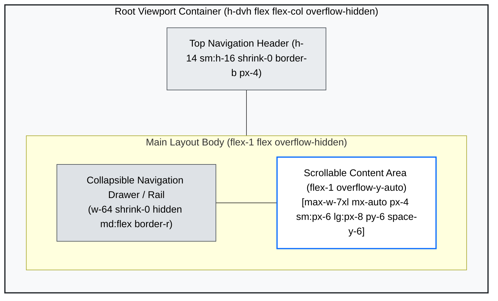
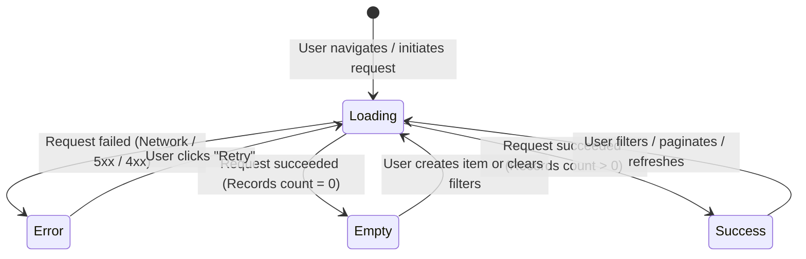

# Universal Frontend Engineering & UI/UX Standards

> **Audience & Authority**: This document establishes the mandatory design system rules, spatial hierarchy, mandatory interactive view states, accessibility guidelines, and verification standards across all web interfaces in the organization.

---

## 1. Component & Styling System

All user interfaces must be built from a cohesive, accessible primitive UI foundation. Uncontrolled CSS, bespoke styling scripts, and random styling solutions are strictly forbidden.

### 1.1 The Enforced Primitive Stack

```
+-----------------------------------------------------------------------------------+
|                           ENFORCED PRIMITIVE UI STACK                             |
+---------------------+----------------------------+--------------------------------+
| Utility Engine      | Primitive Component System | Iconography                    |
| Tailwind CSS v4     | Headless / Radix Primitives| Lucide Icons / SVG Symbols     |
| (Semantic tokens)   | (Ant Design)  | (Accessible, sized via tokens) |
+---------------------+----------------------------+--------------------------------+
```

1. **Utility-First Engine**: Use Tailwind CSS driven by semantic CSS variables (`bg-background`, `text-foreground`, `border-border`).
2. **Accessible Component Primitives**: All interactive controls (Dialogs, Dropdowns, Tooltips, Tabs, Popovers) must extend accessible headless primitives (Ant Design). Never build custom open/close overlays with unhandled outside clicks or escape key handling.
3. **Iconography Standard**: Lucide Icons (or standardized SVG primitives). Icons must always inherit currentColor and carry explicit dimensions (`h-4 w-4`, `h-5 w-5`).

### 1.2 Prohibited Styling Anti-Patterns

| Forbidden Anti-Pattern | Why It Is Banned | Enforced Correct Pattern |
| :--- | :--- | :--- |
| **Ad-hoc `<style>` tags / raw CSS files** | Breaks CSS cascade order, causes bundle fragmentation and specificity wars. | Tailwind utility classes and shared design token variables. |
| **Arbitrary inline styles** (`style={{ marginTop: 23, color: '#333' }}`) | Circumvents the design system; cannot adapt to themes, breakpoints, or hover states. | Standard spacing and semantic token classes: `mt-6 text-foreground`. |
| **Hardcoded hex codes** (`#005899`, `#ffffff`, `#111827`) | Breaks light/dark mode and multi-tenant theming instantly. | Semantic tokens: `text-primary`, `bg-card`, `border-muted`. |
| **Uncontained layout divs** (`<div><div>...</div></div>` tag soup) | Degrades accessibility, causes collapsing margins, and obscures visual intent. | Semantic layout wrappers with clear layout display: `flex flex-col gap-4` or `grid grid-cols-1 md:grid-cols-3`. |
| **Raw clickable icons** (`<Icon onClick={...} />`) | Not keyboard focusable, missing ARIA role, invisible to screen readers. | Accessible button wrapper: `<Button variant="ghost" size="icon" aria-label="Action description"><Icon className="h-4 w-4" /></Button>`. |

---

## 2. Spatial Layout & Hierarchy

A predictable spatial grid creates visual stability across disparate monitors, viewports, and form factors.



### 2.1 The 4pt / 8pt Spacing Rhythm

All margins, paddings, and flex/grid gaps must strictly adhere to the 4/8pt spacing scale. **Arbitrary pixel values (e.g., `mt-[17px]`, `p-[11px]`) are rejected by linting.**

| Spacing Token | Pixels | Rem Equivalent | Primary Architectural Use Case |
| :--- | :--- | :--- | :--- |
| `gap-1`, `p-1` | 4px | 0.25rem | Micro-spacing (icon to text, tight tag padding) |
| `gap-2`, `p-2` | 8px | 0.5rem | Compact item spacing, pill padding, dropdown item padding |
| `gap-3`, `p-3` | 12px | 0.75rem | Small card padding, button padding |
| `gap-4`, `p-4` | 16px | 1.0rem | Standard base spacing: card padding (compact), input height rhythm |
| `gap-6`, `p-6` | 24px | 1.5rem | Standard card padding, grid gutter spacing |
| `gap-8`, `p-8` | 32px | 2.0rem | Section vertical spacing, page header bottom margin |
| `gap-12`, `p-12`| 48px | 3.0rem | Major page section divide, hero layout spacing |

### 2.2 Responsive Breakpoints (Mobile-First)

Media queries must follow progressive enhancement starting from mobile viewports:

- **Mobile Default (`base`)**: `< 640px` (Single column, stacked navigation, collapsed sheets).
- **Tablet (`sm`)**: `>= 640px` (Two-column grids, modal dialogs enabled).
- **Desktop Small (`md`)**: `>= 768px` (Persistent side rail navigation, multi-column filters).
- **Desktop Standard (`lg`)**: `>= 1024px` (Full expanded sidebar, 3-column dashboard grids).
- **Widescreen (`xl` / `2xl`)**: `>= 1280px / 1536px` (Max-width container constraints centered via `mx-auto`).

### 2.3 Typography Scale & Rhythm

Use standardized font sizing and line heights to eliminate text collision and baseline drift:

```
+-----------------------------------------------------------------------------------+
|                                 TYPOGRAPHY SCALE                                  |
+-------------+---------------------+-------------------+---------------------------+
| Utility     | Font Size / Height  | Font Weight       | Usage                     |
+-------------+---------------------+-------------------+---------------------------+
| text-xs     | 12px / leading-4    | normal / medium   | Badges, timestamps, hints |
| text-sm     | 14px / leading-5    | normal / medium   | Table data, form inputs   |
| text-base   | 16px / leading-6    | normal            | Primary body prose        |
| text-lg     | 18px / leading-7    | semibold          | Card headers, subheadings |
| text-xl     | 20px / leading-7    | semibold / bold   | Section titles, modals    |
| text-2xl    | 24px / leading-8    | bold              | Page main headers         |
| text-3xl    | 30px / leading-9    | extrabold         | Hero metrics & dashboards |
+-------------+---------------------+-------------------+---------------------------+
```

---

## 3. Mandatory Interactive Screen States

Every view, data table, card grid, and detail panel MUST explicitly support **four distinct screen states**. Leaving any screen state unhandled or relying on an blank screen during data transitions is considered a defect.



### 3.1 State 1: Loading & Skeletons (Zero Cumulative Layout Shift)

- **Rule**: Never use a single bouncing dot or isolated spinner that abruptly reshapes the page upon data arrival.
- **Implementation**: Skeletons must mirror the exact dimensions, borders, and grid layout of the loaded content.

```tsx
export function TableSkeleton({ rows = 5 }: { rows?: number }) {
  return (
    <div className="w-full rounded-md border border-border">
      <div className="h-10 border-b border-border bg-muted/40 animate-pulse" />
      <div className="divide-y divide-border">
        {Array.from({ length: rows }).map((_, i) => (
          <div key={i} className="flex items-center gap-4 p-4">
            <div className="h-4 w-1/4 rounded bg-muted animate-pulse" />
            <div className="h-4 w-1/2 rounded bg-muted animate-pulse" />
            <div className="h-4 w-1/6 rounded bg-muted animate-pulse" />
          </div>
        ))}
      </div>
    </div>
  );
}
```

### 3.2 State 2: Empty / Zero Data States

- **Rule**: An empty table or list must never render as blank white space.
- **Requirements**:
  1. Semantic, non-threatening icon.
  2. Clear, concise title (`"No items found"`).
  3. Actionable context explaining *why* it is empty (`"You haven't created any items yet, or your active filter returned no results."`).
  4. Primary Call to Action button (`"Create Item"` or `"Clear Filters"`).

```tsx
export function EmptyState({
  icon: Icon,
  title,
  description,
  action,
}: {
  icon: React.ComponentType<{ className?: string }>;
  title: string;
  description: string;
  action?: { label: string; onClick: () => void };
}) {
  return (
    <div className="flex min-h-[320px] flex-col items-center justify-center rounded-lg border border-dashed border-border p-8 text-center">
      <div className="flex h-12 w-12 items-center justify-center rounded-full bg-muted">
        <Icon className="h-6 w-6 text-muted-foreground" />
      </div>
      <h3 className="mt-4 text-lg font-semibold text-foreground">{title}</h3>
      <p className="mt-2 max-w-sm text-sm text-muted-foreground">{description}</p>
      {action && (
        <button
          type="button"
          onClick={action.onClick}
          className="mt-6 inline-flex items-center rounded-md bg-primary px-4 py-2 text-sm font-medium text-primary-foreground shadow hover:bg-primary/90"
        >
          {action.label}
        </button>
      )}
    </div>
  );
}
```

### 3.3 State 3: Error Boundaries & Retry Actions

- **Rule**: Never allow unhandled runtime exceptions to crash the entire page into a blank screen. Never expose raw backend stack traces or database errors to end users.
- **Requirements**:
  1. Wrap feature boundaries in React Error Boundaries.
  2. Provide human-friendly error messages with a distinct Danger status indicator.
  3. Provide an explicit **Retry Action** button that triggers an idempotent re-fetch or state reset.

```tsx
"use client";

import { Component, type ReactNode } from "react";

interface Props {
  children: ReactNode;
  fallback?: (error: Error, reset: () => void) => ReactNode;
}

interface State {
  error: Error | null;
}

export class FeatureErrorBoundary extends Component<Props, State> {
  state: State = { error: null };

  static getDerivedStateFromError(error: Error): State {
    return { error };
  }

  reset = () => {
    this.setState({ error: null });
  };

  render() {
    if (this.state.error) {
      if (this.fallback) return this.props.fallback(this.state.error, this.reset);
      return (
        <div className="rounded-lg border border-destructive/20 bg-destructive/10 p-6 text-center">
          <p className="font-semibold text-destructive">Failed to load this section</p>
          <p className="mt-1 text-sm text-muted-foreground">{this.state.error.message}</p>
          <button
            type="button"
            onClick={this.reset}
            className="mt-4 rounded bg-destructive px-3 py-1.5 text-xs font-semibold text-destructive-foreground hover:bg-destructive/90"
          >
            Retry
          </button>
        </div>
      );
    }
    return this.props.children;
  }
}
```

### 3.4 State 4: Form Validation & Submission Errors

- **Rule**: Forms must be validated against a strict schema (e.g. Zod) via React Hook Form.
- **Requirements**:
  1. **Inline Field Errors**: Displayed directly below the affected input with `aria-invalid="true"` and `aria-describedby="[field]-error"`.
  2. **Prevent Double Submission**: Form submit buttons must show a loading spinner and remain disabled during submission.
  3. **Server Validation Mapping**: Map field-level API 422 errors directly onto form fields using `setError` so the user knows exactly which input failed.

```tsx
"use client";

import { useForm } from "react-hook-form";
import { zodResolver } from "@hookform/resolvers/zod";
import { z } from "zod";

const formSchema = z.object({
  email: z.string().email("Please enter a valid email address"),
});

export function SubscriptionForm() {
  const {
    register,
    handleSubmit,
    formState: { errors, isSubmitting },
  } = useForm<{ email: string }>({
    resolver: zodResolver(formSchema),
  });

  const onSubmit = async (values: { email: string }) => {
    // Submit payload
  };

  return (
    <form onSubmit={handleSubmit(onSubmit)} className="space-y-4" noValidate>
      <div>
        <label htmlFor="email" className="block text-sm font-medium">Email Address</label>
        <input
          id="email"
          type="email"
          {...register("email")}
          aria-invalid={errors.email ? "true" : "false"}
          aria-describedby={errors.email ? "email-error" : undefined}
          className={`mt-1 block w-full rounded-md border p-2 text-sm ${
            errors.email ? "border-destructive focus:ring-destructive" : "border-input"
          }`}
        />
        {errors.email && (
          <p id="email-error" className="mt-1 text-xs text-destructive">
            {errors.email.message}
          </p>
        )}
      </div>
      <button
        type="submit"
        disabled={isSubmitting}
        className="rounded bg-primary px-4 py-2 text-sm text-primary-foreground disabled:opacity-50"
      >
        {isSubmitting ? "Submitting..." : "Subscribe"}
      </button>
    </form>
  );
}
```

---

## 4. Accessibility & Polish (A11y)

All web interfaces must meet **WCAG 2.1 Level AA** compliance.

### 4.1 Keyboard Navigation & Focus Management
- **Logical Tab Order**: All interactive controls must be reachable via the `Tab` key in intuitive reading sequence.
- **Focus Rings**: Focus styles must never be suppressed via `outline-none` unless replaced with a high-contrast focus indicator:
  ```css
  focus-visible:outline-none focus-visible:ring-2 focus-visible:ring-ring focus-visible:ring-offset-2
  ```
- **Escape Key Handling**: All open modals, flyouts, and command dialogs must close immediately on pressing `Escape`.

### 4.2 ARIA Attributes & Semantic HTML
- Prefer native HTML tags (`<nav>`, `<main>`, `<header>`, `<footer>`, `<dialog>`, `<button>`) over generic `<div>` wrappers.
- Provide descriptive `aria-label` for all icon-only buttons or link controls.
- Use `role="alert"` or `aria-live="polite"` for dynamic asynchronous feedback (e.g. status banners, toast messages).

### 4.3 Contrast Ratios
- Standard body text must achieve a minimum contrast ratio of **4.5:1** against its background.
- Large headers and interactive graphical controls must achieve a minimum of **3:1**.
- Verify color contrast across both Light Mode and Dark Mode token themes.

---

## 5. Code Hygiene & Testing Standards

### 5.1 Strict TypeScript Standards
- **Zero `any` Policy**: The `any` type is strictly forbidden. Use `unknown` with type guards, generic parameters, or discriminated unions.
- Enable `noUncheckedIndexedAccess` in `tsconfig.json` to prevent out-of-bounds array access bugs.
- Represent component and query states using **discriminated unions** rather than separate boolean flags:

```ts
// ❌ WRONG: Ambiguous boolean flags allow impossible states
interface BadState {
  isLoading: boolean;
  isError: boolean;
  data?: Item[];
  error?: Error;
}

// ✅ RIGHT: Discriminated union enforces valid state combinations
type ViewState =
  | { status: "idle" }
  | { status: "loading" }
  | { status: "error"; error: Error }
  | { status: "success"; data: readonly Item[] };
```

### 5.2 Unit & Integration Testing (Vitest + React Testing Library)
- Test user interactions and accessibility roles, not implementation details or internal state variables:
- **Test the 4 States**: Every feature test suite must verify the Loading, Empty, Error, and Populated view states.

```tsx
import { render, screen, waitFor } from "@testing-library/react";
import userEvent from "@testing-library/user-event";
import { ItemListContainer } from "./ItemListContainer";

describe("ItemListContainer", () => {
  it("renders empty state when no records are returned", async () => {
    render(<ItemListContainer />);
    expect(await screen.findByText(/no items found/i)).toBeInTheDocument();
  });

  it("handles retry action when an error occurs", async () => {
    // Arrange mock error
    render(<ItemListContainer />);
    const retryButton = await screen.findByRole("button", { name: /retry/i });
    await userEvent.click(retryButton);
    // Verify reload interaction
  });
});
```

### 5.3 End-to-End Testing (Playwright)
- Critical user journeys (authentication, creation workflows, table filtering) must be covered with Playwright E2E tests.
- **Page Object Model (POM)**: Abstract page interactions into reusable page objects.
- **Resilient Locators**: Always locate elements by role and user-facing accessibility labels (`page.getByRole("button", { name: "Submit" })`) rather than brittle CSS selectors (`page.locator(".btn-submit")`).

---

## 6. Engineering Standards Checklist

Before submitting code for review, ensure compliance with this checklist:

- [ ] **No Inline Style Hacks**: No hardcoded colors or unconstrained pixel heights/margins.
- [ ] **Spacing Rhythm**: All paddings and margins conform to the 4/8pt spacing scale.
- [ ] **Complete Interactive States**: View explicitly implements Loading (skeleton), Empty, Error (with retry), and Populated states.
- [ ] **Accessible Controls**: All buttons and inputs are keyboard reachable with visible focus rings and ARIA descriptions.
- [ ] **Type Soundness**: Zero instances of `any`. Discriminated unions represent async states.
- [ ] **Test Coverage**: Critical flows verified with Vitest component tests and Playwright E2E tests.

