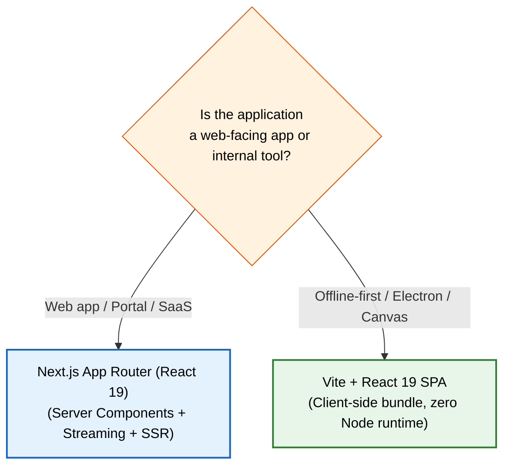

# Universal Frontend Technology Stack & Tooling Specification

> **Audience & Authority**: This document establishes the binding organizational standards for frontend technologies across all current and future web applications. Engineering teams and AI agents must follow this specification to prevent tech debt, package duplication, and framework fragmentation.

---

## 1. Technology Governance Framework

To maintain engineering velocity and architectural consistency, all dependencies are classified into three governance tiers:

```
+-----------------------------------------------------------------------------------------+
|                                TECH STACK GOVERNANCE TIERS                              |
+--------------------------+------------------------------+-------------------------------+
| Tier 1: The Golden Path  | Tier 2: Approved Exceptions  | Tier 3: Strictly Prohibited   |
| Default standard for 90%+ | Permitted only with written  | Banned in new projects;       |
| of new web applications. | architectural justification. | trigger instant PR rejection. |
+--------------------------+------------------------------+-------------------------------+
```

1. **Tier 1 (The Golden Path)**: The default standard for 90%+ of web user interfaces. CI pipelines, linting presets, shared UI packages, and AI agent prompts are tuned specifically for this combination.
2. **Tier 2 (Approved Exceptions)**: Permitted only when explicit project constraints rule out Tier 1 (e.g. pure offline desktop shells, embedded WebGL dashboards, micro-frontends). Requires an Architecture Decision Record (ADR).
3. **Tier 3 (Strictly Prohibited)**: Technologies that introduce maintenance hazards, poor runtime performance, security risks, or architectural anti-patterns. Banned from all new repositories.

---

## 2. Core Matrix & Technology Mapping

| Engineering Domain | Tier 1: The Golden Path (Default) | Tier 2: Approved Exceptions | Tier 3: Strictly Prohibited |
| :--- | :--- | :--- | :--- |
| **Language & Type System** | **TypeScript 5.x+**<br>`strict: true`, `noImplicitAny: true`, `noUncheckedIndexedAccess: true` | — | Plain JavaScript, TypeScript with relaxed types or `any` |
| **Meta-Framework & Runtime** | **Next.js (App Router)**<br>React 19 (Server Components + Client Leaves) | **Vite + React 19**<br>(Offline-first SPAs, Tauri/Electron webviews, internal tools) | Create React App (CRA), Next.js Pages Router (legacy) |
| **Package Management** | **pnpm 9+ / 11** with workspace protocols | Standalone **pnpm** (single repos) | `npm`, `yarn v1 (classic)`, Lerna |
| **Monorepo Build Orchestrator** | **Turborepo** | standalone scripts (single repos) | Nx (unless org-mandated), custom shell scripts |
| **Styling & Token Engine** | **Tailwind CSS v4**<br>(CSS variables, design token layers) | Vanilla CSS Modules (custom canvas/WebGL) | Sass / SCSS, CSS-in-JS (styled-components, Emotion)* |
| **Primitive UI Components** | **Ant Design v6** (token-configured) | Headless UI | Unstyled raw HTML controls, Material UI (v4/v5)* |
| **Iconography** | **Lucide Icons** (SVG primitives via currentColor) | System SVG Sprites | Font Awesome / icon fonts, hardcoded base64 SVGs |
| **Data Fetching & Caching** | **TanStack Query v5** or **SWR v2**<br>(Structured key factories, optimistic mutations) | Native `fetch` with Next.js Cache (pure RSC views) | Axios, jQuery AJAX, raw un-cached `useEffect` fetching |
| **Client State Management** | **Zustand** (vanilla factory + Context)<br>**Nuqs** (URL query param state) | React Context + `useReducer` (micro-scopes) | Redux / Redux Toolkit (boilerplate overhead), MobX |
| **Forms & Schema Validation** | **React Hook Form + Zod** | Ant Design Form + Zod validator | Formik (deprecated performance), unvalidated forms |
| **Internationalization (i18n)** | **next-intl** (Catalog-driven, zero i18n deps in UI primitives) | FormatJS / react-intl | Raw hardcoded copy strings, client-only `i18next` without SSR |
| **Unit & Integration Testing** | **Vitest + React Testing Library** | — | Jest (slow ESM support), Enzyme |
| **End-to-End (E2E) Testing** | **Playwright** (Page Object Model, role locators) | Cypress | Selenium, Puppeteer |
| **Component Explorer** | **Storybook 8+** (Vite / Next framework builder) | — | Ad-hoc isolated preview pages |
| **Linting & Code Formatting** | **ESLint 9 (Flat Config)** + **Prettier** | — | Legacy `.eslintrc.*`, TSLint, Biome (until org migration) |

*\* Note on CSS-in-JS (Emotion / styled-components): Incompatible with React Server Components (RSC) and causes runtime style recalculation overhead.*

---

## 3. Detailed Domain Specifications

### 3.1 Language & Type System

- **Standard**: TypeScript 5.x+ in full strict mode.
- **Required Compiler Options (`tsconfig.json`)**:
  ```json
  {
    "compilerOptions": {
      "target": "ES2022",
      "lib": ["DOM", "DOM.Iterable", "ES2022"],
      "module": "NodeNext",
      "moduleResolution": "Bundler",
      "strict": true,
      "noImplicitAny": true,
      "strictNullChecks": true,
      "noUncheckedIndexedAccess": true,
      "exactOptionalPropertyTypes": false,
      "noFallthroughCasesInSwitch": true,
      "skipLibCheck": true,
      "forceConsistentCasingInFileNames": true
    }
  }
  ```
- **Guidelines**:
  - `any` is strictly prohibited. Use `unknown`, generic parameters, or discriminated unions.
  - Arrays accessed by index are treated as `T | undefined` via `noUncheckedIndexedAccess`. Guard with explicit checks or optional chaining.

### 3.2 Meta-Framework & Application Runtime



- **Primary Standard**: **Next.js (App Router)** with React 19.
  - Leverages Server Components (RSC) to minimize client bundle footprints and eliminate API roundtrip waterfalls.
  - Page routes default to Server Components; client interactivity is isolated to leaf nodes.
- **Secondary Exception**: **Vite + React 19**.
  - Permitted only for pure client SPAs, offline desktop wraps (Tauri/Electron), or canvas-heavy internal dashboards where Node.js SSR is unnecessary or impossible.

### 3.3 Package Management & Monorepo Tooling

- **Package Manager**: **pnpm** (versions 9+ or 11).
  - Uses hard link and symlink stores to ensure deterministic, zero-phantom dependency graphs.
  - Inter-package dependencies within monorepos must use `"workspace:*"`.
- **Build Orchestration**: **Turborepo**.
  - Task pipelines (`turbo.json`) define dependencies: `build`, `lint`, `check-types`, and `test`.
  - Caching preserves build outputs across developer machines and CI pipelines.

### 3.4 Styling, Design System & Iconography

- **Styling Standard**: **Tailwind CSS v4**.
  - Declares theme layers before import: `@layer theme, base, antd, components, utilities`.
  - Driven entirely by semantic CSS variables (`var(--app-color-bg)`, `var(--app-color-text)`).
  - Forbids runtime CSS-in-JS due to RSC incompatibility and performance penalties.
- **Component Primitives**:
  - **Headless Option**: **Radix UI** primitives styled via **shadcn/ui**.
  - **Enterprise Option**: **Ant Design v6** configured strictly via algorithmic theme tokens (`ConfigProvider` + `getAntdTheme` mapping to semantic CSS variables).
- **Iconography**: **Lucide Icons**.
  - Lightweight tree-shakable SVG components.
  - Must inherit color via `currentColor` and receive responsive dimensions (`h-4 w-4`).

### 3.5 Data Fetching, Network Transport & Caching

- **Transport**: Standardized typed `HttpClient` built over native `fetch`.
  - Automatic `AbortController` timeout handling (15s default).
  - Standard envelope unwrapping (`BaseResponse<T>`).
  - Standard error classification (`ApiError`, `NetworkError`).
- **Caching & Synchronization**: **TanStack Query v5** or **SWR v2**.
  - Query keys must be defined as readonly tuple factories (e.g. `['items', 'detail', id] as const`).
  - Mutations must specify optimistic UI rollback behaviors (`rollbackOnError: true`).
  - Streaming endpoints (SSE / WebSockets) synchronize directly with cache mutations.

### 3.6 State Management & Navigation

- **URL State**: **Nuqs** (Type-safe search params for Next.js).
  - Filters, search terms, pagination indices, and active tabs MUST live in URL search params.
  - Eliminates state synchronization bugs on page refresh or link sharing.
- **Global Client State**: **Zustand**.
  - Must be created via vanilla factory functions (`createStore`) and provided via React Context.
  - Prevents singleton store state leaks across server-rendered SSR requests.
  - Components subscribe via atomic selectors and `useShallow`.

### 3.7 Forms & Schema Validation

- **Standard**: **React Hook Form** + **Zod**.
  - Forms validate against strict Zod schemas via `@hookform/resolvers/zod`.
  - Uncontrolled inputs minimize component re-renders during keystrokes.
  - Field errors display inline with `aria-invalid="true"` and `aria-describedby`.

### 3.8 Internationalization (i18n)

- **Standard**: **next-intl** (or pure catalog resolvers).
  - **Architecture Firewall**: Primitive UI packages must **never** import i18n libraries directly. Primitives receive typed `labels: ComponentLabels` props.
  - Message catalogs are pure data JSON/TypeScript structures.
  - Locales resolve via middleware or URL path prefixes (`/[locale]/...`).

### 3.9 Testing, Verification & UI Explorer

- **Unit & Integration**: **Vitest** + **React Testing Library**.
  - Vitest provides native ESM and fast parallel execution.
  - RTL tests verify accessible roles and behavior across all 4 mandatory interactive screen states (Loading, Empty, Error, Success).
- **End-to-End (E2E)**: **Playwright**.
  - Page Object Model (POM) pattern.
  - Resilient locators using user-facing accessibility queries (`getByRole`, `getByLabel`).
- **Component Workshop**: **Storybook 8+**.
  - Provides visual regression testing, documentation, and theme verification across light and dark tokens.

---

## 4. Architectural Decision Matrix (Why These Choices?)

```
+--------------------------------------------------------------------------------------------------+
|                                    TECHNOLOGY TRADEOFF MATRIX                                    |
+--------------------------+------------------------------+----------------------------------------+
| Technology Choice        | Core Advantage               | Rejection Rationale for Alternative    |
+--------------------------+------------------------------+----------------------------------------+
| Next.js App Router (RSC) | Zero client bundle data load | Pages Router has client-waterfall lag; |
|                          | and streaming HTML.          | CRA is unmaintained and dead.          |
+--------------------------+------------------------------+----------------------------------------+
| Tailwind CSS v4          | Static compile, zero runtime | CSS-in-JS (Emotion) breaks in RSC and  |
|                          | overhead, tokenized cascade. | causes runtime style recalculations.   |
+--------------------------+------------------------------+----------------------------------------+
| TanStack Query / SWR     | Declarative cache, deduping, | Redux/Thunks require 10x boilerplate   |
|                          | background revalidation.     | for simple network cache management.   |
+--------------------------+------------------------------+----------------------------------------+
| Zustand + Nuqs           | Lightweight, SSR context safe| Redux has high bundle weight; MobX     |
|                          | URL-as-truth integration.    | relies on opaque observable proxies.   |
+--------------------------+------------------------------+----------------------------------------+
| Vitest + Playwright      | Native ESM, instant startup, | Jest is slow on modern ESM; Cypress    |
|                          | cross-browser multi-tab E2E. | lacks native multi-tab / worker tests. |
+--------------------------+------------------------------+----------------------------------------+
```

---

## 5. Technology Adoption & Migration Checklist

When onboarding an existing repository or bootstrapping a new project, verify alignment against this checklist:

- [ ] **Package Manager**: Repo uses `pnpm` with lockfile checked into version control.
- [ ] **TypeScript Configuration**: `strict: true` and `noUncheckedIndexedAccess: true` enabled.
- [ ] **CSS System**: Zero CSS-in-JS dependencies; all styling is driven by Tailwind CSS and design tokens.
- [ ] **Data Layer**: Network requests managed by SWR or TanStack Query; no unmanaged `useEffect` fetching.
- [ ] **State Separation**: URL state handled via search params; client state scoped with Zustand.
- [ ] **Forms**: Validated with Zod schemas and React Hook Form.
- [ ] **Testing Tooling**: Test suites execute on Vitest; critical journeys verified via Playwright.
- [ ] **No Prohibited Dependencies**: Verification confirms absence of CRA, Axios, Formik, Enzyme, or Emotion.

